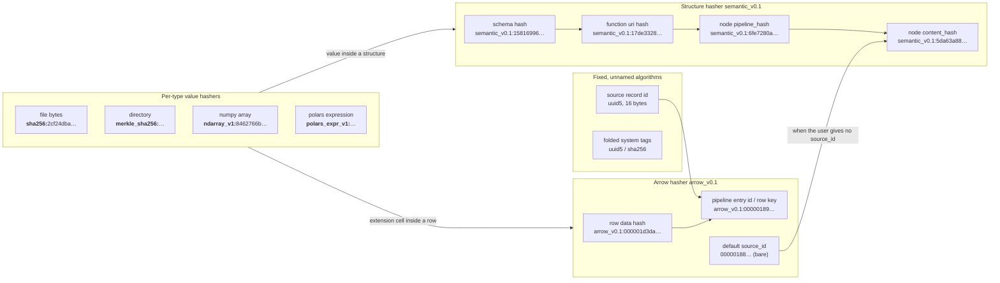
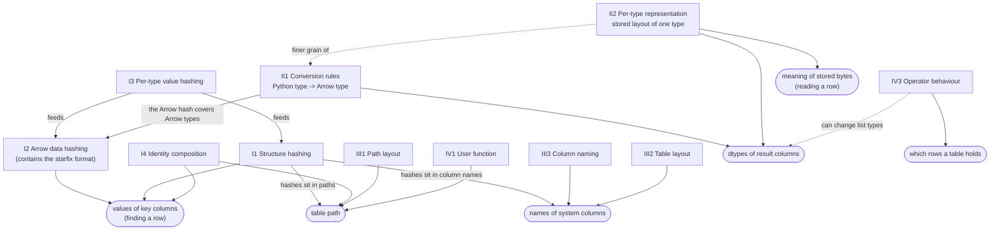
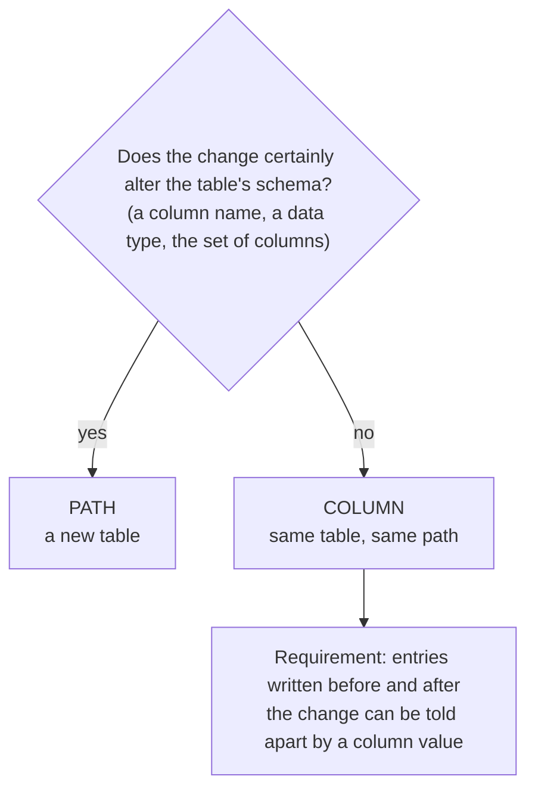
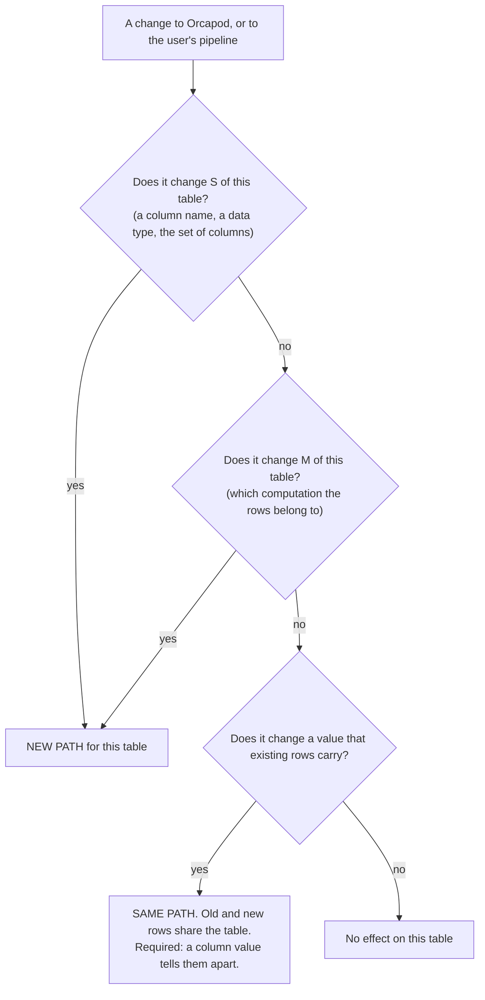
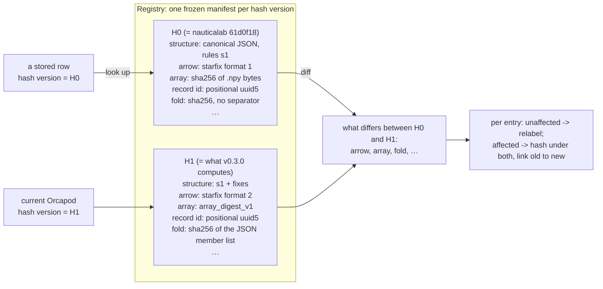

# ITL-938: one coherent versioning system for hashes, hash labels and stored paths

Status: **design discussion closed on November 11, 2026.** Every decision is the developer's
and is listed, dated and quoted, in Part 9. Where an earlier part shows an intermediate view,
the later part governs; **Part 7.1 is the system on one page.** Decisions the developer made
later the same day, while the implementation issues were in progress, are listed at the end of
Part 9 and applied throughout.

| Part | Content |
|---|---|
| 1 | What exists today: hashers, where each hash is stored, the store on disk, every version marker, measured failure modes |
| 2, 3 | The axes along which Orcapod's behaviour can change, and what each one affects |
| 4 | The path-or-column rule |
| 5 | The system: schema and subject; every change from the old version to v0.3; the data context as the global hash version; logical types; labels |
| 6 | Paths before and after v0.3; side-effecting nodes |
| 7 | The system on one page; what lands before the v0.3 tag and what follows; what ITL-910 must change; the data context file |
| 8 | Follow-up issues to file, with issue and pull request numbers where they exist |
| 9 | Decisions |
| Appendix A | Every hash computation site and what affects its result |

Linear: [ITL-938](https://linear.app/metamorphic/issue/ITL-938). Design only; no library code.

**How the facts here were obtained.** Everything was read from the code on `origin/main` at
`d61e3e39` and checked by running it on November 11, 2026. Comparisons with ITL-910 ran a
snapshot of `origin/eywalker/itl-910-adopt-starfix-05-hash-format-2-in-orcapod` at `6df680ce`
(starfix 0.5.0). Every hash string quoted is a real value from those runs. Items read from
code but not exercised by a run are marked "(code only)".

**The probe pipeline** used for all examples:

```python
s1 = DictSource([{"id": 0, "x": 5}, {"id": 1, "x": 10}, {"id": 2, "x": 15}], tag_columns=["id"], source_id="source1")
s2 = DictSource([{"id": 0, "y": 3}, {"id": 2, "y": 6}, {"id": 4, "y": 9}], tag_columns=["id"], source_id="source2")

@function_pod(output_keys="doubled")
def double(x: int) -> int: return 2 * x

@function_pod(output_keys="sum")
def take_sum(doubled: int, y: int) -> int: return doubled + y

job = PipelineJob(name="my_pipeline", store=DeltaTableDatabase("./store"))
with job:
    take_sum.pod(double.pod(s1, label="double").join(s2, label="join"), label="sum")
job.run()
```

**Terms.**

| Term | Meaning |
|---|---|
| Label | The text in front of a digest that names the algorithm, as in `arrow_v0.1:000001d3da…`. In code: `ContentHash.method`. |
| Labelled / bare | A stored hash is *labelled* when the label is stored with the digest, *bare* when only hex or raw bytes are stored. |
| Preimage | The exact bytes or structure fed into a hash function. |
| Key column | A column whose value is used to find a row (a lookup or row key). |
| Axis of change | One independent way in which Orcapod's behaviour can change between two versions of the code. |

---

## Part 1. What exists today

### 1.1 Where hashing happens



| Label | What it hashes | Algorithm | Where the label is set |
|---|---|---|---|
| `semantic_v0.1` | Python structures: schemas, function identity, node identity, every `content_hash()` and `pipeline_hash()` | SHA-256 of canonical JSON of the expanded structure. A nested hash is embedded as its labelled string, so **labels are part of the preimage** of every enclosing hash | `contexts/data/v0.1.json`; duplicated in `hashing/versioned_hashers.py` (no callers) and `contexts/data/schemas/context_schema.json` |
| `arrow_v0.1` (ITL-910: `arrow_v0.2`) | Arrow tables and schemas: each row's data hash, row keys | starfix `ArrowDigester`. The digest is 35 bytes: starfix's own 3-byte format number (`000001` for starfix 0.4, `000002` for 0.5), then SHA-256 | same three places |
| `sha256` | file content | SHA-256 of the bytes. The label is the algorithm name; it has no version | `hashing/hash_utils.py` |
| `merkle_sha256` | directory content | Merkle tree over entries; child file labels are dropped from the preimage | `hashing/directory_hashers.py` |
| `ndarray_v1` | `numpy.ndarray` values | `array_digest_v1` over dtype tag, shape, bytes | `builtin_handlers.py`, `logical_types/array_format.py` |
| `polars_expr_v1` | `polars.Expr` filter predicates | SHA-256 of canonical JSON of an Orcapod-owned expression tree | `semantic_hashing/polars_expr.py` |
| not on main yet | `torch_tensor_v1` (PR #300); `polars_dataframe_v1`, `polars_series_v1` (PR #286); `pandas_dataframe_v1`, `pandas_series_v1`, `arrow_table_v1` (ITL-897 branches) | per-type handlers | — |
| no label | PR #292 class identity `Point@9117beaa…` (SHA-256 of a JSON description); the two `uuid5` namespaces for record ids; `combine_hashes` for folded system tags | fixed algorithms with no name | — |

An extension-typed cell inside an Arrow table is hashed as
`<extension name>::<label>:<digest>`, so per-type labels sit inside the preimage of every
Arrow hash that covers such a cell.

### 1.2 Where each hash is stored

| Hash | Computed from | Hasher | Stored form | Stored where |
|---|---|---|---|---|
| Node `content_hash()` | source: class, schema, `source_id`; operator or function: its identity + upstream content hashes | semantic | labelled string `semantic_v0.1:5da63a88…` | saved job JSON (node keys, edges, `content_hash`, `node_job_content_hashes`); column `__node_content_hash` (labelled bytes); path component `instance:…` when `table_scope="content_hash"`; cached-source path `source/node:…` (code only) |
| Node `pipeline_hash()` | schemas and topology only, never data | semantic | labelled string `semantic_v0.1:6fe7280a…` | path component `schema:semantic_v0.1:6fe7280a…`; saved job JSON; **bare hex** inside system-tag column names after Join, MergeJoin, Batch, GroupBy |
| Schema hash of a source | `(tag_schema, data_schema)` | semantic | **bare hex**, 64 chars | system-tag column names `_tag_source_id::52eb0af7…`, `_tag_record_id::52eb0af7…` |
| Function `uri` | `(name, semantic hash of output schema, "v"+major, type id)` | semantic | `('double', 'semantic_v0.1:17de3328…', 'v0', 'python.function.v0')` | **four path components** of both function tables; saved job JSON; inside every `_source_<col>` token of function outputs |
| Operator `uri` | `(ClassName, content hash)` | semantic | **bare hex** `('Join', '295ca933…')` | operator cache path (code only); saved job JSON |
| Row data hash | the row's data columns as an Arrow table | arrow | labelled bytes `b"arrow_v0.1:"` + 35 bytes | `__input_data_hash`, `__output_data_hash`; opt-in `_content_hash` column (labelled string) |
| Pipeline entry id | Arrow table of (system-tag columns + `__input_data_hash`) | arrow | labelled bytes | `__pipeline_base_entry_id`; with the recomputation index it gives the row key `__record_id` of the pipeline table |
| Result row key, `__data_id` | random `uuid7` of the output datagram | none | 16 raw bytes | `__record_id` in the result table; `__data_id` in the pipeline table; inside `_source_<col>` tokens |
| Source record id | `uuid5(namespace, "{source_id}::{row token}")` | fixed, unnamed | 16 raw bytes | values of `_tag_record_id::…` columns |
| Folded record id / source id (Batch, GroupBy) | `uuid5` / SHA-256 over the members | fixed, unnamed | 16 raw bytes / bare hex | values of system-tag columns |
| Default `source_id` | Arrow hash of the source table | arrow | **bare hex**, 70 chars: `000001883080da70…` | `_tag_source_id::…` values, `_source_<col>` tokens, and through them the source's content hash |
| Function signature / content hash | signature; function components | semantic | labelled bytes | `__pf_var_function_signature_hash`, `__pf_var_function_content_hash` |
| Operator cache row key | Arrow hash of the row incl. `__node_content_hash` | arrow | **bare hex** | `_record_hash` (code only) |
| File-hash cache entry | key `(path, mtime, size)`; value labelled digest | sha256 | the key has no algorithm in it | SQLite / Postgres cache table, outside the store |

### 1.2.1 The two identity chains, source identity and source entry identity

Every node has two hashes, both made by the structure hasher, both chained from its upstreams.
They differ in one thing: what a **source** contributes at the bottom of the chain.

```
                          PIPELINE IDENTITY                       CONTENT IDENTITY
                          (schemas + topology)                    (pipeline identity + which sources)

 source1                  (tag schema, data schema)               (class, tag schema, data schema, source_id)
   id:int, x:int          semantic_v0.1:52eb0af7…                 semantic_v0.1:d644c803…
      │                         │                                       │
      ▼                         ▼                                       ▼
 double                   (function uri, upstream pipeline hash)  (function uri, upstream content hash)
                          semantic_v0.1:6fe7280a…                 semantic_v0.1:5da63a88…
      │                         │                                       │
      │   source2               │   semantic_v0.1:1560128e…             │   semantic_v0.1:c6411778…
      ▼      ▼                  ▼      ▼                                ▼      ▼
 join                     ("Join", {upstream pipeline hashes})    ("Join", {upstream content hashes})
                          semantic_v0.1:87a24180…                 semantic_v0.1:50c289b4…
      │                         │                                       │
      ▼                         ▼                                       ▼
 take_sum                 semantic_v0.1:1417915f…                 semantic_v0.1:48ddd935…

 USED FOR                 the table path:                         telling rows apart inside a shared table:
                            …/schema:semantic_v0.1:1417915f…/       column __node_content_hash
                          system-tag column names (bare):         path component instance:… (table_scope="content_hash")
                            _tag_source_id::52eb0af7…::6fe7280a…:1 node keys and edges in the saved job file
```

So two pipelines with the same shape and schemas but different sources write to the **same
tables**, and their rows are separated by `__node_content_hash`.

**Source identity** has three levels, and each one feeds a different stored thing:

| Level | Computed from | Example value | Feeds |
|---|---|---|---|
| Source pipeline identity | `(tag schema, data schema)` only | `semantic_v0.1:52eb0af7…` (the same for `source1` and for any other source with columns `id:int, x:int`) | every downstream pipeline hash, so every table path; the bare hex in system-tag column names |
| Source content identity | `(class name, schemas, source_id)` | `semantic_v0.1:d644c803…` for `source_id="source1"`; `…9da643df…` for `source_id="other_name"` with the same rows | every downstream content hash; `__node_content_hash`; saved job file |
| `source_id` | given by the user (`"source1"`), or when absent the bare Arrow hash of the whole table (`000001883080da70…`) | — | source content identity; values of `_tag_source_id::…`; the front of every source-info token and of every record id |

The contract (developer, November 11, 2026): a source decides whether its identity reflects
its exact content or is an *address* for it, such as a repository. Inside a source, each entry
carries a unique and reliable record id. Orcapod trusts that the same `source_id` and the same
record id mean exactly the same data entry.

```
 source_id      = which repository          "source1"            -> content identity, _tag_source_id
 record id      = which entry inside it     uuid5("source1::row_2") -> _tag_record_id, entry id
 source-info    = which value of the entry  "source1::row_2::x"  -> _source_x
```

Two measured consequences:

- With a user-given `source_id`, the source's content hash does **not** cover its data, by
  design: changing one value (`x: 5` to `x: 99`) leaves it at `semantic_v0.1:d644c803…`. The
  changed row is still distinguished downstream, by its row data hash.
- With no `source_id`, the source's content hash depends on the **Arrow hasher** through the
  default id: the same rows give `semantic_v0.1:d8eb49fa…` on main and `…5b6ae6d2…` on
  ITL-910. This is the one place where an Arrow-hasher change leaks into the structure-hash
  chain (and into cached-source paths).

**Source entry identity** (the identity of one row of a source) has two parts:

| Part | Computed from | Example | Stored where | Feeds |
|---|---|---|---|---|
| Record id | `uuid5(fixed namespace, "{source_id}::{row token}")`; the token is `row_{i}` (position) or `{column}={value}` | row 2 of `source1`: token `source1::row_2`, id `dbbded85-3b31-5aa1-8070-7b5a41d74c5b` | value of `_tag_record_id::52eb0af7…` (16 bytes, bare) | the pipeline entry id of every downstream row |
| Source-info token | `{source_id}::{row token}::{column}` | `source1::row_2::x` | value of `_source_x` | provenance only; not hashed into keys |
| Row data hash | the row's data columns | `{"x": 15}` -> `arrow_v0.1:000001d0e4…` | `__input_data_hash` | the result-table lookup key and the pipeline entry id |

How these combine into the key of a stored row:

```
 record ids of the contributing source rows ──┐   (system-tag columns: uuid5, bare)
   _tag_record_id::52eb0af7…::6fe7280a…:1     │
   _tag_record_id::1560128e…::1560128e…:0     ├──► Arrow hash ──► __pipeline_base_entry_id ──┬──► __record_id
                                              │                   arrow_v0.1:00000103…       │    arrow_v0.1:0000012f…
 row data hash of the input ──────────────────┘                                              │
   __input_data_hash  arrow_v0.1:00000196…                __pipeline_recomputation_index ────┘
```

The record id is positional today: reordering a source's rows changes `row_2` to another
index and so changes every downstream key. ITL-817 proposes deriving it from content.

Which axis of Part 2 each of these sits on:

| Thing | Axis |
|---|---|
| What a source contributes to each chain (schema only; schema + `source_id`) | I4 Identity composition |
| That the chains are hashed with the structure hasher | I1 Structure hashing |
| The record-id recipe (namespace, token format, positional or content-derived) | I4 Identity composition |
| The default `source_id` being an Arrow table hash | I4 (the choice) and I2 (the value) |
| The entry-id recipe (system tags + input data hash) | I4 Identity composition |
| That the entry id is hashed with the Arrow hasher | I2 Arrow data hashing |
| The source-info token format | III3 Column naming |

### 1.2.2 System tags and source-info columns through an operator chain

Two families of hidden columns travel with every row. They are where source identity
(1.2.1) and the operator chain meet, and both hold hashes.

| Family | Columns | What it records | Is it hashed into row keys? |
|---|---|---|---|
| **System tags** | a pair per contributing source: `_tag_source_id::<suffix>` and `_tag_record_id::<suffix>` | which source, and which row of it, this row descends from. The column **name** records the route the row took through multi-input operators | **yes**: the entry id is the Arrow hash of all system-tag columns (names, types and values) plus the input data hash |
| **Source info** | one per data column: `_source_<column>` | where each data value came from: a source row, or a function invocation | no: provenance only |

Measured at each stage (the row for `id=2`; hashes shortened, all bare `semantic_v0.1` hex):

```
source1                                              pipeline hash 52eb0af7…
   _tag_source_id::52eb0af7…                         "source1"
   _tag_record_id::52eb0af7…                         dbbded85…   fixed_size_binary[16]   = uuid5("source1::row_2")
   _source_x                                         "source1::row_2::x"
        │
        ▼  double  (function pod)                    NAME-PRESERVING
   _tag_source_id::52eb0af7…                         "source1"
   _tag_record_id::52eb0af7…                         dbbded85…   large_binary            <- type changed
   _source_doubled                                   "double:semantic_v0.1:17de3328…:v0:python.function.v0::<uuid7>::doubled"
        │                                            (the source-info token is REPLACED by the function's)
        ▼  join with source2                         NAME-EXTENDING: append ::<input pipeline hash>:<position>
   _tag_source_id::1560128e…::1560128e…:0            "source2"
   _tag_record_id::1560128e…::1560128e…:0            01e2b591…
   _tag_source_id::52eb0af7…::6fe7280a…:1            "source1"         52eb0af7 = source1's schema hash
   _tag_record_id::52eb0af7…::6fe7280a…:1            dbbded85…         6fe7280a = pipeline hash of `double`, the join input
   _source_y                                         "source2::row_1::y"
   _source_doubled                                   unchanged
        │
        ▼  batch                                     REDUCING: values fold to one digest; append ::<input pipeline hash>
   _tag_source_id::1560128e…::1560128e…:0::87a24180… "36f89629…"  (bare SHA-256 of the members' source ids)
   _tag_record_id::1560128e…::1560128e…:0::87a24180… 1ddcf99a…    (uuid5 over the members' record ids)
   _tag_source_id::52eb0af7…::6fe7280a…:1::87a24180… "6baf7889…"
   _tag_record_id::52eb0af7…::6fe7280a…:1::87a24180… 7f463412…
   _source_y                                         ["source2::row_0::y", "source2::row_1::y"]      large_list<large_string>
   _source_doubled                                   ["double:…::doubled", "double:…::doubled"]
```

What the name of a system-tag column encodes, piece by piece:

```
_tag_record_id :: 52eb0af7… :: 6fe7280a… : 1 :: 87a24180…
└──────┬──────┘   └───┬───┘    └───┬───┘  └┬┘   └───┬───┘
  which field    schema hash   pipeline   its     pipeline hash of the
  (source id or  of the        hash of    canonical  stream that Batch /
   record id)    source        the join   position   GroupBy reduced
                               input      in the join
```

Facts measured on this chain:

| Fact | Evidence |
|---|---|
| A join is commutative: `join(double, source2)` and `join(source2, double)` give the same pipeline hash `87a24180…` and identical column names | both orders run |
| Two sources with the same schema are told apart in the name only by position: `merge_join(source1, source3)` gives `…::52eb0af7…::52eb0af7…:0` and `…:1` | run |
| Every hash inside a column name is a bare structure hash. A structure-hasher change renames every system-tag column in every stored table | names above |
| The values are bare too: a record id is 16 raw bytes; a folded source id is 64 hex characters with no label | values above |
| The record-id column is `fixed_size_binary[16]` out of a source and `large_binary` after a function pod. The entry id is an Arrow hash over these columns, so the Arrow type of a system-tag column is part of every downstream row key | types above |
| A function pod replaces the source-info token of its outputs with its own: uri, the output's `uuid7`, the column. The uri inside carries a labelled structure hash, separated by the same `:` the label uses | `_source_doubled` |
| Reducing operators turn source info into lists and keep system tags scalar (a digest) | `batch` |

Which axis of Part 2 each piece sits on:

| Piece | Axis |
|---|---|
| The column-name grammar (`_tag_…::hash::hash:pos::hash`, separators, which hashes are appended and when) | III3 Column naming |
| That the hashes in the names are structure hashes | I1 Structure hashing |
| Which hash is appended (the input's pipeline hash, not its content hash) and the canonical ordering of join inputs | I4 Identity composition |
| The fold recipe for reducing operators (`uuid5` over record ids, SHA-256 over source ids) | I4 Identity composition |
| The Arrow type of system-tag and source-info columns | II1 Conversion rules |
| The source-info token grammar (`{source_id}::{row token}::{column}`; `{uri}::{uuid7}::{column}`) | III3 Column naming |
| That system tags are hashed into the entry id, and source info is not | I4 Identity composition |
| How each operator evolves the two families (preserve, extend, reduce) | IV3 Operator behaviour |

So system tags are the point where four axes meet: a change to structure hashing (I1), to
column naming (III3), to identity composition (I4) or to an operator's behaviour (IV3) each
changes the **names** of stored columns, which by the developer's rule must show in the path,
and each changes the entry id, so old rows cannot be found.

### 1.3 The store on disk

**Anatomy of a path** (the pipeline table of node `double`):

```
store/my_pipeline/double/semantic_v0.1:17de3328…a26939/v0/python.function.v0/schema:semantic_v0.1:6fe7280a…b9ec94/pdb_v1
      └────┬────┘ └─┬──┘ └──────────────┬─────────────┘ └┬┘ └───────┬────────┘ └──────────────────┬───────────────┘ └─┬──┘
        job name  function     hash of the function's  function  function wrapper     pipeline hash of the node     layout of
                   name          output schema          major        kind             (schemas + topology above it)  this table
                                 [structure hasher]     version                       [structure hasher]
                  └──────────────────────── function uri ───────────────────────┘
```

**All tables written by the probe pipeline:**

```
store/
└── my_pipeline/
    ├── double/semantic_v0.1:17de3328…/v0/python.function.v0/schema:semantic_v0.1:6fe7280a…/pdb_v1/    pipeline table, 3 rows
    ├── take_sum/semantic_v0.1:d50b00b6…/v0/python.function.v0/schema:semantic_v0.1:1417915f…/pdb_v1/  pipeline table, 2 rows
    └── _result/
        ├── double/semantic_v0.1:17de3328…/v0/python.function.v0/rdb_v1/                               result table, 3 rows
        └── take_sum/semantic_v0.1:d50b00b6…/v0/python.function.v0/rdb_v1/                             result table, 2 rows
```

- The join has no table: operator nodes are not cached by default.
- The **result table** path has no pipeline hash. It holds the function's outputs keyed by the
  hash of the input row, and is shared by every node that uses that function.
- The **pipeline table** holds one row per (input row, node): its tags, and a pointer
  (`__data_id`) to the output in the result table.
- Other table kinds (code only): operator cache `<Class>/<bare hash>/schema:…` (no layout
  suffix), cached source `source/node:<content hash>`, side-effect log `…/schema:…/tdb_v1`,
  status and log tables `…/execution_status`, `…/execution_logs`.
- Non-Delta backends (SQLite, Postgres, Spiral) turn the same path tuple into a table name.

**Anatomy of a pipeline-table row** (`take_sum`, row for `id=2`), grouped by what each column
is for:

```
 USED TO FIND THE ROW (keys)
   __record_id                  arrow_v0.1:0000012f…        row key = entry id + recomputation index
   __pipeline_base_entry_id     arrow_v0.1:00000103…        hash of (system tags + input data hash)
   __input_data_hash            arrow_v0.1:00000196…        hash of the input row's data; lookup key into the result table
   __node_content_hash          semantic_v0.1:48ddd935…     which node (and so which sources) wrote the row
   __data_id                    16 bytes (uuid7)            pointer to the output row in the result table

 USER-VISIBLE CONTENT (tags; the data columns live in the result table)
   id                           2

 PROVENANCE CARRIED WITH THE ROW (system tags, source info)
   _tag_source_id::1560128e…::1560128e…:0     "source2"         column NAME embeds bare structure hashes
   _tag_record_id::1560128e…::1560128e…:0     16 bytes (uuid5)
   _tag_source_id::52eb0af7…::6fe7280a…:1     "source1"
   _tag_record_id::52eb0af7…::6fe7280a…:1     16 bytes (uuid5)
   _source_y                    "source2::row_1::y"
   _source_doubled              "double:semantic_v0.1:17de3328…:v0:python.function.v0::<uuid7>::doubled"

 DESCRIPTION OF HOW THE ROW CAME TO BE
   __output_data_hash           arrow_v0.1:000001c1…
   __input_data_context_key     "std:v0.1:default"          written, never read
   __computed, __is_ephemeral, __pipeline_recomputation_index
```

The result table adds: `__pf_var_function_name`, `__pf_var_function_signature_hash` and
`__pf_var_function_content_hash` (labelled `semantic_v0.1:`), `__pf_var_git_hash`,
`__pf_exec_executor_type`, `__pf_exec_python_version` (`3.12.15`), `_context_key`
(`std:v0.1:default`; read back to choose the data context for a cached row), `__pod_ts`.

**Main versus the ITL-910 branch.** Same directory tree, same node content and pipeline
hashes, same column names. Only the Arrow-hashed values differ:

| | main (starfix 0.4) | ITL-910 (starfix 0.5) |
|---|---|---|
| Path of `double` pipeline table | `…/schema:semantic_v0.1:6fe7280a…/pdb_v1` | identical |
| Row data hash, `{"x": 5}` | `arrow_v0.1:000001d3daa548b1…` | `arrow_v0.2:000002136ffea0f7…` |
| Default source id | `000001883080da70…` | `00000243d6b9f563…` |
| Content hash of a source with that default id | `semantic_v0.1:d8eb49fa…` | `semantic_v0.1:5b6ae6d2…` |
| `ndarray_v1`, `sha256`, schema and uri hashes | — | identical |

### 1.4 Every version, label and format marker

| # | Marker | Values today | What it is meant to capture | Who bumps it, when | Can a reader tell which version wrote a stored value? | What moves when it is bumped |
|---|---|---|---|---|---|---|
| 1 | Structure hasher label | `semantic_v0.1` | the algorithm for hashing Python structures | never bumped; hash-moving fixes went in under the same label (PR #301 proposes another) | yes where labelled; no in column names and operator uri | every content and pipeline hash, every function path, every system-tag column name |
| 2 | Arrow hasher label | `arrow_v0.1` -> `arrow_v0.2` (ITL-910) | the algorithm for hashing Arrow data. Rule accepted Nov 11, 2026: bump whenever any hash can change | Orcapod, by editing the context JSON | yes in labelled columns; only by the starfix prefix in bare hex | row hashes and row keys. **No path** |
| 3 | starfix format number | `000001`, `000002` | starfix's own byte format | starfix | yes | same as 2 |
| 4 | Per-type value labels | `sha256`, `merkle_sha256`, `ndarray_v1`, `polars_expr_v1`, pending others | the hash definition of one value type | type author. Rule in PR #300: bytes under a label never change | only inside a preimage; not stored next to the cell | any hash covering such a value |
| 5 | Data context key and version | `std:v0.1:default`, `v0.1` | the whole bundle: both hashers, the type converter, the registered types and handlers | **never bumped**: `v0.1.json` has been edited in place 20 times | the key is in every result row but is the same string before and after every change | nothing |
| 6 | Table layout suffixes | `pdb_v1`, `rdb_v1`, `tdb_v1` | the column layout of Orcapod's own tables | Orcapod, on a layout change | by path only: `SchemaVersionError` when a table exists **without** the suffix and none with it; `NodeConfig(ignore_schema=("v0",))` opts out | the last path component. `tdb_v1` and operator cache tables have no check |
| 7 | Function major version | `v0` (from `version="v0.0"`) | the user's statement that results changed | the user | yes | function uri, both function table paths |
| 8 | Function wrapper kind | `python.function.v0` | how a function is called and its outputs packaged | Orcapod; hard-coded in four files | yes | function table paths |
| 9 | Stored representation versions | array format `{"version":1}` in Arrow extension metadata; PR #308 nullability `{"format":"orcapod.nullability","version":1}`; all other types: none | the byte layout of a stored value | type author | arrays: yes, an unknown version raises. Others: no | nothing |
| 10 | Saved file formats | `orcapod_pipeline_version: 0.1.0`, `orcapod_pipeline_job_version: 0.1.0` | the JSON layout of a saved pipeline or job | Orcapod | yes; load rejects unknown versions. Hashes inside are trusted | nothing |
| 11 | File-hash cache table version | `1` | the cache table's layout | Orcapod | yes | nothing |
| 12 | Package version | `0.2.x` -> `0.3.0` | the release | release process | **no: written nowhere in a store** | nothing |
| 13 | Golden files | 685 pinned values, 5 files | a test that hashes do not move | regenerated only with approval | — | ITL-910 changes 186 |
| 14 | `table_scope` | `pipeline_hash` / `content_hash` | not a version: whether a node's table is shared across data or private to one input | user, per node | yes, in saved JSON | adds an `instance:…` path component |

Three naming conventions coexist: `_v0.1` (hashers), `_v1` (per-type labels, table layouts),
`0.1.0` (files).

### 1.5 What stays the same and what changes today (measured)

| Change made | Function uri | Pipeline hash | Table path | Row data hash |
|---|---|---|---|---|
| Baseline `double` | `('double', 'semantic_v0.1:17de3328…', 'v0', 'python.function.v0')` | `…6fe7280a…` | baseline | `arrow_v0.1:000001d3da…` |
| Edit the function body (`x + x`) | same | same | **same** (by design) | same |
| Minor version `v0.7` | same | same | **same** | same |
| Major version `v1.0` | `…, 'v1', …` | `…ea0cf7b3…` | **moves** | same |
| Rename to `twice` | `('twice', …)` | `…0de069df…` | **moves** | same |
| Return type `float` | `…'semantic_v0.1:1f13e266…'…` | `…868ee85c…` | **moves** | same |
| Rename output key to `twice_x` | `…'semantic_v0.1:b680b6b1…'…` | `…0e5702c0…` | **moves** | same |
| Different source name (`other_name`) | same | same (`52eb0af7…` for the source) | **same**; rows are told apart by `__node_content_hash` | same |
| Source column `int32` instead of `int64` | same | same | **same** | `arrow_v0.1:0000014dff…` (**differs**) |
| Arrow label `arrow_v0.1` -> `arrow_v0.2` | same | same | **same** | `arrow_v0.2:…` (**differs**) |
| Structure label -> `semantic_v0.2` | `…'semantic_v0.2:03141c1e…'…` | `semantic_v0.2:800bf59e…` | **moves** | same |

### 1.6 Failure modes, reproduced

| # | Change | What happens today | How it was reproduced |
|---|---|---|---|
| F1 | Arrow label changes, nothing else | Same paths. Every lookup misses, everything recomputes, new rows are **appended to the same tables**: 6 rows for 3 inputs | main with the label patched, on a store written by main |
| F1' | Same, on the ITL-910 branch tip | `StoreHashLabelError` naming the table, node and both labels; nothing read or written | ITL-910 snapshot on a store written by main |
| F2 | Structure label changes, nothing else | **Every function path moves.** The run succeeds, recomputes into new tables, leaves the old ones behind. No error: stored results silently look dropped | main with the label patched |
| F3 | One hasher's label changes but not the other | The two hashers behave in opposite ways (F1 mixes rows, F2 orphans tables) | F1 + F2 |
| F4 | A stored representation changes | Arrays: an unknown version raises `ValueError … expected metadata b'{"version":1}' but got b'{"version":2}'`. Every other type has no version | forged `{"version":2}` column |
| F5 | The data context changes | The stored `_context_key` is the same string before and after | `v0.1.json` changelog |
| F6 | A hash is stored bare | System-tag column names, operator uri, default source ids, operator-cache row keys: a reader cannot tell which algorithm made them | inventory 1.2 |
| F7 | A hash-moving fix ships without a label bump | Looks like a cache miss: silent recompute, mixed rows | PR #301 as proposed |
| F8 | The stored Arrow type of a column differs while its Python type is the same (`int32` vs `int64`) | Same pipeline hash, same path. The second run fails at commit with `StoreWriteError … Cannot append to the stored table`, **after** its rows were already written to the result table (4 rows for 2 inputs) | two `ArrowTableSource`s, same job |

```
F1  Arrow label moves                     F2  Structure label moves

  …/schema:…6fe7280a…/pdb_v1/               …/double/semantic_v0.1:17de3328…/…/pdb_v1/   <- old rows, never read again
    arrow_v0.1 row  id=0  ┐ old             …/double/semantic_v0.2:03141c1e…/…/pdb_v1/   <- new rows
    arrow_v0.1 row  id=1  │ never match
    arrow_v0.1 row  id=2  ┘                 no error, no warning
    arrow_v0.2 row  id=0  ┐ new
    arrow_v0.2 row  id=1  │
    arrow_v0.2 row  id=2  ┘
  a full read returns 6 rows
```

---

## Part 2. The axes of change

Part 1 lists markers. This part sets them aside and asks a different question: **in which
independent ways can Orcapod's behaviour change between two versions of the code?** Each such
way is an axis. A marker is only a name we choose to give to a position on an axis.

### 2.1 The hierarchy

```
Release (0.2.x, 0.3.0)                       any axis below can only move with a release
│
├── I. IDENTITY RULES                        how a hash value is produced
│   ├── I1  Structure hashing                Python structures -> hash          today: semantic_v0.1
│   ├── I2  Arrow data hashing               rows and tables -> hash            today: arrow_v0.1
│   │   └── starfix byte format                                                 today: 000001
│   ├── I3  Per-type value hashing           one value type -> hash             today: ndarray_v1, sha256, polars_expr_v1 …
│   └── I4  Identity composition             WHAT goes into each identity       today: no marker
│           ├── function identity   (name, output-schema hash, major version, wrapper kind)
│           ├── operator identity   (class name + parameters)
│           ├── source identity     (class, schema, source_id)
│           ├── record-id recipe    (uuid5 namespace, "{source_id}::{row token}")
│           ├── entry-id recipe     (system tags + input data hash)
│           └── system-tag fold     (how Batch / GroupBy combine members)
│
├── II. TYPE RULES                           how a Python value becomes stored data
│   ├── II1 Conversion rules                 Python type -> Arrow type          today: no marker
│   │       (int -> int64, str -> large_string, nullability, list -> large_list)
│   └── II2 Per-type representation          stored layout of one type          today: {"version":1} for arrays only
│           (array = struct<dtype, shape, data>; file = JSON {"path": …})
│
├── III. STORE LAYOUT                        how Orcapod arranges its bookkeeping
│   ├── III1 Path layout                     which components, in which order   today: no marker
│   ├── III2 Table layout                    system columns per table kind      today: pdb_v1, rdb_v1, tdb_v1
│   ├── III3 Column naming                   _tag_…::hash:pos, _source_…,       today: no marker
│   │                                        format of source-info tokens
│   └── III4 Backend encoding                how a backend writes Arrow         today: nullability version (PR #308)
│
└── IV. COMPUTATION BEHAVIOUR                what is computed
    ├── IV1 User function                    name, signature, major version     today: in the uri (user-controlled)
    ├── IV2 Function wrapper kind            how a function is called/packaged  today: python.function.v0
    ├── IV3 Operator behaviour               which rows Join, Batch … emit      today: no marker
    └── IV4 Execution environment            Python version, executor, git hash today: columns __pf_exec_*

Outside the store, independent of all of the above:
    saved pipeline / job file format (0.1.0)        file-hash cache table (1)
```

### 2.2 How the axes relate



Reading the diagram:

- **Finer grain.** II2 is a finer grain of II1 (one type's layout versus the rules for all
  types). The starfix format is a finer grain of I2. I3 is a finer grain of both I1 and I2,
  because a value's hash is consumed by whichever hasher covers the thing containing it.
- **Dependency.** I2 depends on II1: the Arrow hash covers Arrow types, so changing how `int`
  is stored changes every row hash even though the hashing algorithm did not change
  (measured: the same values as `int32` hash to `arrow_v0.1:0000014dff…`, as `int64` to
  `arrow_v0.1:000001d3da…`).
- **Paired but independent.** For one type, II2 (how it is stored) and I3 (how it is hashed)
  are separate. The array format was designed so that the hash is by value: a future storage
  change need not move `ndarray_v1` hashes, and a hash fix need not change storage.
- **Independent.** Store layout (III) is independent of identity and type rules, except that
  column names (III3) embed I1 hashes. Computation behaviour (IV) is independent of all three.

### 2.3 Each axis in detail, with examples

For each axis: what it is, a change that has happened or could, and what should stay the same
and what should change.

#### I1 Structure hashing

How a Python structure (a schema, a function's identity, a node's identity) becomes a hash.

- Example values: `Schema({'x': int})` -> `semantic_v0.1:15816996…`; function output schema
  -> `semantic_v0.1:17de3328…`; node pipeline hash -> `semantic_v0.1:6fe7280a…`.
- A change on this axis: PR #301 (a dict's insertion order no longer affects its hash).
  A different canonical JSON form would be another.
- When it changes: every content and pipeline hash changes, so every hash in a path and every
  system-tag column name changes. Row data hashes (`arrow_v0.1:…`) do **not** change.
- Should stay the same when: data changes, a function body is edited, the Arrow hasher changes.

#### I2 Arrow data hashing

How a row or table of Arrow data becomes a hash.

- Example values: row `{"x": 5}` -> `arrow_v0.1:000001d3daa548b1…`.
- A change on this axis: starfix 0.4 -> 0.5 (ITL-910): the same row becomes
  `arrow_v0.2:000002136ffea0f7…`.
- When it changes: every row key changes (`__input_data_hash`, `__pipeline_base_entry_id`,
  pipeline-table `__record_id`), and default source ids. No column name, no dtype, no path.
- Should stay the same when: the structure hasher changes; a function is renamed.

#### I3 Per-type value hashing

How one value of a given type becomes a hash.

- Example values: `np.arange(3, dtype="int16")` -> `ndarray_v1:8462766b…`; the same numbers
  as `int64` -> `ndarray_v1:44ef444a…` (dtype is part of identity); a file containing
  `hello` -> `sha256:2cf24dba…`.
- A change on this axis: ITL-888 moved arrays from hashing `.npy` bytes (label `sha256`) to
  hashing by value (label `ndarray_v1`).
- When it changes: every row hash of a row holding that type, and every structure hash that
  contains such a value (a `polars.Expr` inside a filter operator's identity). Tables that
  never hold the type are unaffected.
- Should stay the same when: the type's stored layout changes but its value does not.

#### I4 Identity composition

What goes into an identity, as opposed to how it is hashed. Nothing marks this axis today.

- Example: a function's identity is the tuple
  `('double', 'semantic_v0.1:17de3328…', 'v0', 'python.function.v0')`. Deciding that the
  input schema should also be part of it is a change on this axis.
- Example: a source's identity is `(class, schema, source_id)`. Measured consequence: two
  `DictSource`s with the same `source_id="source1"` but one different value have the **same**
  content hash `semantic_v0.1:d644c803…`.
- Example: a source row's record id is `uuid5(namespace, "source1::row_2")`. ITL-817 proposes
  deriving it from content instead.
- Example: an operator's identity is its class name and parameters (`Join` ->
  `('Join', '295ca933…')`).
- When it changes: depends on which identity. A function-identity change moves paths; a
  record-id change moves `_tag_record_id` values and, through the entry id, every row key.

#### II1 Conversion rules

How a Python type maps to an Arrow type.

- Example: `int` -> `int64`; `str` -> `large_string`; `list[int]` -> `large_list<int64>`;
  `int` (required) -> non-nullable, `int | None` -> nullable.
- A change on this axis: the November 10 rule "always normalize to large variants".
  A hypothetical one: storing Python `int` as `int32`.
- When it changes: the dtype of result columns, and through I2 every row hash.
- Today the path does **not** move: the schema hash covers Python type names, not Arrow types
  (F8: `int32` and `int64` sources give the same pipeline hash `52eb0af7…` and the same path).

#### II2 Per-type representation

The stored layout of one logical type.

- Example: an array is stored as extension `orcapod.ndarray` over
  `struct<dtype, shape, data>` with metadata `{"version":1}`. Before v0.3 it was extension
  `numpy.ndarray` over `large_binary` holding `.npy` bytes.
- Example: `orcapod.file` changed from a plain path string to JSON `{"path": "…"}` (ITL-451)
  under the same name, with no marker.
- When it changes: the dtype of columns holding that type (if the layout changes shape), or
  the meaning of the bytes (if the shape is the same). Ideally not the hash (see I3).
- Today the path moves only if the type is renamed, because the schema hash uses the type's
  name. A `{"version":2}` layout under the name `orcapod.ndarray` would keep the path.

#### III1 Path layout

Which components a table path has and in what order. Example: adding a generation name at the
front, or putting the pipeline hash into the result table's path. No marker today; a change
is visible only as tables appearing somewhere else.

#### III2 Table layout

The system columns of each kind of table.

- Example: `pdb_v1` introduced labelled-bytes hash columns in place of `"method:hex"` strings
  and renamed `_node_content_hash` to `__node_content_hash`.
- A table without the suffix is "v0"; meeting one raises `SchemaVersionError`. Only the
  pipeline and result tables are checked.

#### III3 Column naming

The names Orcapod gives to columns it adds to streams.

- Example: a system-tag column is named `_tag_source_id::<schema hash>` and after a join
  `_tag_source_id::52eb0af7…::6fe7280a…:1` (source schema hash, then the pipeline hash and
  position of the join input).
- Example: a source-info token is `source1::row_2::x`.
- A change on this axis: truncating the hashes in column names, or a different separator.
- When it changes: names of system columns in every stored table, and (because system tags
  are hashed into the entry id) possibly every row key.

#### III4 Backend encoding

How one backend physically writes an Arrow table. Example: SpiralDB stores every column as
nullable, so PR #308 records nullability in table metadata under `__orcapod_nullability__`
with `"version": 1`. This axis is per backend and invisible to every hash.

#### IV1 User function

The user's function: name, signature, major version. The user controls it; all three are in
the uri and so in the path (table in 1.5). Body edits are excluded by design.

#### IV2 Function wrapper kind

`python.function.v0`: how Orcapod calls a function and packages its outputs. In the uri and
the path.

#### IV3 Operator behaviour

Which rows an operator emits, in what order, with what list types. Nothing marks this axis
today: `Join`'s identity is the string `"Join"`.

- Example of a change: `MergeJoin` sorting its merged lists differently, or `GroupBy` ordering
  members by a different tiebreaker. The pipeline hash and path stay the same while the rows
  written differ.
- Example that also changes a dtype: `Batch` typing its list columns as `large_list` instead
  of `list`.

#### IV4 Execution environment

Python version, executor, git hash of the user's code. Recorded per row
(`__pf_exec_python_version = '3.12.15'`). It affects neither where a row is found nor how it
is read.

---

## Part 3. The impact of each axis

The developer's rule (November 11, 2026): **anything that changes the schema of the result or
tag tables (a column name, a dtype, an added column) must be reflected in the path of the
table.** The last column measures today's code against that rule.

| Axis | Result column names or dtypes | System column names or dtypes | Values of key columns (old rows cannot be found) | Meaning of stored bytes (old rows misread) | Reaches the path today? |
|---|---|---|---|---|---|
| I1 Structure hashing | no | **yes**: system-tag column names embed these hashes | yes | no | Yes, as a side effect: hashes in the path change; old tables are orphaned silently (F2) |
| I2 Arrow hashing | no | no | yes, every row key | no | **No** (F1) |
| I3 Per-type hashing | no | no | yes, where rows hold the type | no | No |
| I4 Identity composition | no | sometimes | yes | no | Only if the changed identity is in the path |
| II1 Conversion rules | **yes** (dtype) | no | yes | possibly | **No** (F8) |
| II2 Per-type representation | **yes** if the layout changes shape | no | no, if the hash is by value | **yes** | Only if the type is renamed |
| III1 Path layout | no | no | no | no | It is the path |
| III2 Table layout | no | **yes** | no | no | Yes for pipeline and result tables; not for the other kinds |
| III3 Column naming | no | **yes** | possibly | no | **No** |
| III4 Backend encoding | as physically stored | as physically stored | no | yes | No |
| IV1 User function | yes (signature) | no | — | — | Yes |
| IV2 Wrapper kind | possibly | possibly | — | — | Yes |
| IV3 Operator behaviour | possibly | possibly | no | **yes**: same path, different rows | **No** |
| IV4 Environment | no | no | no | no | No, and correctly: it is recorded in columns |

Measured against the rule, **four axes break it today**: II1, II2, III3 and IV3. I1 satisfies
it only by accident, and without any way to find the old tables.

How a change reaches a path today, when it does:

```
  (a) by an explicit name      …/v0/…            …/pdb_v1          the reader can look for the old name
  (b) through a hash value     …/semantic_v0.1:17de3328…/…         the old path cannot be derived from the new one
  (c) not at all               arrow label, Arrow types, operator behaviour, column naming
```

---

## Part 4. Path or column: the rule (decided)

**Decision (developer, November 11, 2026):** "Only things that would certainly change the
schema of the table needs to be part of the path. Something that changes the value of a
column while still preserving the schema (same column names, same data types), can happily
reside within the same table (and thus share the path) as long as distinct entries within the
table can be told apart to reflect the difference in how the entry has come out to be (e.g.
minor version or hash of function content exactly makes it in as column values because we
want to keep track of these differences but nothing about schema would change as long as all
tracked components in the path such as output value schema changes)."

This replaces the test first proposed here (which also sent key-value changes to the path).



### 4.1 The rule applied to each axis

This table is the state when the rule was decided. The gaps it lists are closed by the later
decisions: the data context column (5.4, 5.5), logical type identifiers (5.5), the restored
function version column (7.2) and the label rule (5.6), which also fixes the form of a
default source id (rule 5a).

"Told apart today?" asks whether a stored row already carries a value that distinguishes the
two sides of a change on that axis.

| Axis | Changes the schema? | Verdict | Told apart today? | Gap |
|---|---|---|---|---|
| I1 Structure hashing | **yes**: system-tag column names embed structure hashes | path | the path already moves, because the hashes in it change | the old path cannot be derived from the new one; no way to find the old table |
| I2 Arrow hashing | no: values of key columns only | column | **yes**: every Arrow-hashed value carries its label (`arrow_v0.1:` / `arrow_v0.2:`) | bare Arrow hashes (default `source_id`, operator cache key) carry only starfix's prefix |
| I3 Per-type value hashing | no | column | **no**: the row hash `arrow_v0.1:…` does not say which array or file hash definition was used inside it | needs a marker, or the rule "bump the Arrow label whenever any hash can change" must cover per-type changes |
| I4 Identity composition (record-id recipe, entry-id recipe, folds) | no, except where it changes column names | column | **no**: record ids and folded ids are bare bytes | needs a marker |
| I4 Identity composition (function identity, operator identity) | no | column | partly: the function uri is in the path and in `_source_` tokens | — |
| II1 Conversion rules | **yes**: data types | path | — | **the path does not move today** (F8) |
| II2 Per-type representation | **yes** when the stored type changes | path | — | the path moves only if the type is renamed |
| III2 Table layout | **yes** | path | — | `pdb_v1` / `rdb_v1` exist; other table kinds have none |
| III3 Column naming | **yes** | path | — | the path does not move today |
| III4 Backend encoding | as physically stored | per backend | — | — |
| IV1 User function: output schema | **yes** | path | already in the path | — |
| IV1 User function: name | no | path today | identifies which function the table belongs to | — |
| IV1 User function: major version | no | **path today**; a column by the rule | in the path | to decide: keep as a deliberate partition, or make it a column that the lookup must match |
| IV1 User function: minor version | no | column | **no: not stored anywhere** | add a column |
| IV1 User function: body | no | column | **yes**: `__pf_var_function_content_hash` (hash of the source text) | — |
| IV2 Wrapper kind | possibly | path today | in the path | — |
| IV3 Operator behaviour | no (usually) | column | **no** | nothing marks it; and putting it in the operator's identity would change pipeline hashes and so system-tag column names, which makes it a path change |
| IV4 Execution environment | no | column | **yes**: `__pf_exec_python_version`, `__pf_exec_executor_type`, `__pf_var_git_hash` | — |

### 4.2 What "told apart" has to cover

A value-level change that affects **key columns** has two consequences inside a shared table:

```
 one table:  …/schema:semantic_v0.1:6fe7280a…/pdb_v1

   __input_data_hash          __pipeline_base_entry_id      id
   arrow_v0.1:000001d3da…     arrow_v0.1:00000189…           0     ┐ written before the change
   arrow_v0.1:000001b277…     arrow_v0.1:000001a4…           1     ┘
   arrow_v0.2:000002136f…     arrow_v0.2:0000027c…           0     ┐ written after the change
   arrow_v0.2:00000275c5…     arrow_v0.2:000002e1…           1     ┘

 (1) A lookup by key cannot match across the two groups: the key values differ.
     Nothing wrong is ever returned, but nothing old is ever found either.
 (2) A read of the whole table returns both groups: 4 rows for 2 inputs,
     unless the reader selects one group by the distinguishing value.
```

So for each value-level axis the system needs to say (a) which column value distinguishes the
groups, and (b) what a reader does with rows from another group: skip them, fail, or reuse
them. Point (b) is open.

### 4.3 Concrete cases under the rule

| Case | Schema changes? | Verdict | Distinguishing value |
|---|---|---|---|
| starfix 0.4 -> 0.5 (`arrow_v0.1` -> `arrow_v0.2`) | no | same table | the label inside `__input_data_hash`, `__pipeline_base_entry_id`, `__record_id` |
| Arrays move from `.npy` bytes in `large_binary` to `struct<dtype, shape, data>` | yes | new path | — |
| A future array layout `{"version":2}` with the same struct | to decide: is the extension metadata part of the "data type"? | — | — |
| Dict insertion order stops affecting structure hashes (PR #301) | yes for nodes whose hashes move: paths and system-tag column names change | new path | — |
| A SpiralDB table gains the nullability metadata (PR #308) | yes (nullability is part of the type) | new path | — |
| `GroupBy` changes its member tiebreaker | no | same table | none today |
| Record ids become content-derived (ITL-817) | no | same table | none today |
| User edits a function body | no | same table | `__pf_var_function_content_hash` |
| User bumps the minor version | no | same table | none today |
| User upgrades Python 3.12 -> 3.13 | no | same table | `__pf_exec_python_version` |

---

## Part 5. The system (draft, under discussion)

### 5.1 The core logic

A table's path is the name of two things and nothing else:

| | What it is | For a function's pipeline table | For a function's result table |
|---|---|---|---|
| **Schema (S)** | the column names and data types actually stored | tag columns; system-tag columns (their names embed upstream schema and pipeline hashes); Orcapod's bookkeeping columns | the function's output columns; `_source_<col>` columns; bookkeeping columns |
| **Subject (M)** | what one row stands for | "one input entry of this function, at this position in this chain of steps" | "one result of this function": its name, major version, wrapper kind |

Everything else about a row, how it came to be, is a column value.



The logic is applied **per table**. One change can move some tables and leave others alone.

Why a structure-hash change moves paths *by its nature*: the names of system-tag columns embed
the schema hash of each source and the pipeline hash of each join input. When an upstream
schema's hash changes, the column names of every downstream pipeline table change, which is a
change of S. Measured on a pipeline `array source -> size -> inc`, v0.2.0 against main:

| Table | Own columns hold an array? | Change in S | Path |
|---|---|---|---|
| pipeline table of `size` | no (tags and system tags only) | `_tag_record_id::8a81bfa1…` becomes `_tag_record_id::f0b7551d…` | moves (`…7c1aad1b…` -> `…26e8aefa…`) |
| pipeline table of `inc`, one step further down | no | same rename | moves (`…7d689f45…` -> `…67de61d1…`) |
| result table of `inc` (`n: int -> m: int`) | no | none | **stays**, results reused |

### 5.2 Every change from the old version to v0.3: what changed, where it shows, how to migrate

**Baseline.** The old deployed version is `nauticalab/orcapod-python` at `61d0f18` with starfix
0.4.0. The tables below were measured against the tag `v0.2.0`, which contains that commit plus
15 later commits. The same script was then run on `61d0f18` itself: every value in the first
table is identical to `v0.2.0`. See 5.4 for the one stored difference found. **Target.** `main` at `d61e3e39` plus the open pull
requests expected in v0.3.

**Method.** One script builds a source and a function node for each kind of column and prints
the stored type, the row data hashes, the schema and pipeline hashes, and the system-tag
columns of a join and a batch. It was run on `v0.2.0`, on `main`, and on snapshots of PR #309
(ITL-910), PR #292 and PR #301.

**Result in one table.** "same" means byte-identical between `v0.2.0` and the version named.

| Column kind | `main` | + PR #309 starfix 0.5 | + PR #292 class identity | + PR #301 dict order |
|---|---|---|---|---|
| `int`, `str`, `float`, `bool`, `int \| None`, `list[int]`, nested list, `Path`, `File`, `DataFrame` | same: type, hashes, paths | row data hash only: `arrow_v0.1:000001\|8065521a…` becomes `arrow_v0.2:000002\|5682a627…` | same | same |
| `dict[str,int]` | same | row data hash only | same | row data hash of a dict written in another key order: `…63b89b7a…` becomes `…33a846ce…` (equal to the same dict in sorted order) |
| `numpy.ndarray` | **stored type** `numpy.ndarray` over `large_binary` becomes `orcapod.ndarray` over `struct<dtype, shape, data>`; row hash `…45f0d32e…` becomes `…a1920ba5…`; schema hash `21afcd86` becomes `3c83b899`; function output-schema hash `67e09e1a` becomes `272e93f6`; all paths of such nodes move | row data hash label and value | — | — |
| dataclass, pydantic model | same | row data hash only | **logical type name** `inv_models.Point` becomes `inv_models.Point@1a18cd5e…` (storage `struct<x, y>` unchanged); row hash `…16134b5a…` becomes `…07101202…`; schema hash `90a5ffbb` becomes `9fbb8279`; output-schema hash `0c513ac2` becomes `aa6490d2`; all paths of such nodes move | same |
| default `source_id` (no id given) | same | `000001883080…` becomes `00000243d6b9…`; the source's content hash `d8eb49fa` becomes `5b6ae6d2` | same | same |
| system-tag column names and types, join and batch pipeline hashes, folded values, source-info tokens | same | same | same | same |
| table layout (`pdb_v1`, `rdb_v1`), path grammar, bookkeeping columns | same | same | same | same |

**Change by change.**

| # | Change | What changed | Where it shows | Outcome by the logic of 5.1 | Migration |
|---|---|---|---|---|---|
| 1 | Array format (ITL-888, merged) | arrays stored as a value-based struct, not `.npy` bytes; hashed by value | stored column type and logical type name; value-hash label `sha256` becomes `ndarray_v1`; row data hashes; schema, output-schema and pipeline hashes; system-tag column names downstream; result and pipeline table paths | schema changes: new path for every table with an array column and every pipeline table downstream | **Possible from the old store alone.** Read the old table at its old path (the old path is computable: same structure hasher, old type name), decode the `.npy` bytes, write the struct, recompute keys. Not for values v0.3 refuses: a masked array's mask was dropped silently on write, so the stored value is already not what the user had |
| 2 | starfix 0.5 (ITL-910, PR #309) | the Arrow hash algorithm. Format 1 lost information: nested-list lengths, a null struct versus a struct of nulls, booleans (also chunk-dependent) | label and prefix of every Arrow-hashed value: `__input_data_hash`, `__output_data_hash`, `__pipeline_base_entry_id`, the pipeline row key; bare default `source_id` and what derives from it (record ids, `_tag_source_id` values, `_source_` tokens, the source's content hash, content-scoped and cached-source paths) | values only: same path; old and new rows share the table, told apart by the label | **Possible when the inputs can be obtained again** (sources still available, or upstream results in the store). A key is the hash of an *input*, and a function's tables do not store its inputs. Procedure: re-derive each input row, match the old row by its tags (the developer's decision of November 11), write a new pipeline row with the new key pointing at the existing result, and a result row keyed by the new input hash. **Not blindly safe for inputs that hold nested lists, nullable structs or booleans:** under format 1 two different inputs could share one key, so an old row may point at the result of a different input. Detectable during migration: if two old rows shared an input hash and their re-derived inputs get different new hashes, the later one must be recomputed |
| 3 | Polars filter predicates (ITL-828, merged) | a predicate becomes hashable | new values only (`polars_expr_v1`) | nothing existing moves: `v0.2.0` raised `TypeError` for a predicate filter; a filter by `constraints` is unchanged (`98590003` on both) | Nothing to migrate |
| 4 | User class identity (PR #292) | a dataclass or pydantic column's logical type name gains a fingerprint of the class's fields | logical type name in the stored column; row data hashes (the name is part of the hashed cell); schema, output-schema and pipeline hashes; system-tag column names downstream; table paths | schema changes (the logical type is part of the data type): new path | **Possible with the user's class definition.** The stored struct is unchanged; rows are copied under the new type name and re-keyed. The fingerprint comes from the current class, so the class must still match the stored fields; a class that changed since cannot be matched |
| 5 | Dict and set order (PR #301) | equal dicts and sets hash the same whatever their insertion order | row data hashes of rows holding a dict or set written in a non-sorted order; no label of its own | values only: same path. Told apart only because the Arrow label moves in the same release | **Possible.** Under the old rule equal values could have several keys, never the reverse, so no result is attached to the wrong input. Re-key; where two old rows collapse to one key, keep one |
| 6 | Spiral nullability (PR #308) | Spiral tables record which columns are non-nullable | table metadata `__orcapod_nullability__`; for a Spiral source, column types `int \| None` become `int`, so schema hashes and paths | schema changes for those tables: new path | A table without the metadata reads as before; one that gains it is a new schema |
| 7 | New value types (PR #300 torch, PR #286 Polars values) | new logical types | new type names and labels | nothing existing moves | Nothing to migrate |
| 8 | Wrong-hash fixes (ITL-942, PR #315) | **H** the Batch/GroupBy source-id fold is the SHA-256 of the canonical JSON member list (it was a concatenation with no separator), and the record-id fold encodes `None` as `null`; **I** the Arrow hasher hashes the declared nested type, with or without data; **L1** a set is ordered by canonical JSON text, so its hash no longer depends on the process; dict keys keep their type (`{1: "x"}` no longer equals `{"1": "x"}`); a user mapping with a `"__type__"` key can no longer equal one of the hasher's own encodings (type handlers return `Encoded`); **F** a column selection's identity is the sorted list of unique names; **G** the record-id column is `large_binary` everywhere; **T** namedtuple fields are hashed in declared order; **N** one default function version, `v0.0` | H: folded `_tag_source_id` values after Batch or GroupBy. G: the content hash of a raw source-builder stream. F: pipeline hashes and paths of nodes after a column selection written as a tuple, a set, or an unsorted or repeating list. N: paths of `from_fn` and `side_effect_function_pod` pods with no explicit version (`…/v1/…` becomes `…/v0/…`). The others: only the hashes of the values that were wrong. **Nothing moves for MergeJoin** (finding E is intended behaviour, A.9). Measured on the golden files: 7 entries changed (4 for H, 3 for G), 32 added, none removed | values, except F and N, which move a path with no change of schema; no stored schema changes | Per fix. F is a rename, migratable by moving the table (the old path is computable); for N, passing `version="v1.0"` keeps the old path. The fold collision could have attached one identity to two different member lists; affected rows are recomputed |
| 9 | Behaviour fixes (merged: ITL-884, ITL-878, ITL-847/829; open: PR #299, PR #293) | Delta refuses a changed column type instead of casting silently; a failed store write fails the run; SemiJoin handles nested columns; outputs must match the declared type; Delta reads return every row | no hash, label, type or path | nothing moves | No migration. Old stores may hold values written under the old behaviour (a silently cast column, an output that did not match its declared type); these cannot be told apart from correct rows by anything stored |
| 10 | `GroupBy` keeps non-key tags as tags (ITL-955, PR #316) | a tag that is not a grouping key stays a list-valued **tag** column, as with `Batch`. It used to become a list-valued data column, a bug against the rule that no data element may come from a tag value | the tag and data columns of the grouped stream; the data hash of each grouped row; the all-null `_source_<tag>` columns are gone | **no pipeline hash and no table path moves** (neither commits to the operator's output schema); values only | A function that took a moved tag as a parameter must drop it. A stored `source -> GroupBy -> select data columns -> pod` chain reuses its results without recomputation. A tag value needed as data comes from a derived source (row 11) |
| 11 | Derived source with tags as data (ITL-939, PR #317) | new: `DerivedSource(origin, tags_as_data={tag: data_name})`, also `node.as_source(tags_as_data=…)`, keeps the origin's tags and offers chosen tag values as data columns. It is a source, not an operator, because its data comes from tag values. Its default `source_id` is `tags_as_data:<algorithm label>:<hex>` (5.6, rule 5a; the pull request is being updated from `derived:`) | new values only | nothing existing moves | Nothing to migrate |
| 12 | Default source ids built from a hash (ITL-939, PR #317; ITL-945, PR #314; ITL-957, not started) | a default id built from a hash is `<source kind>:<algorithm label>:<hex>` (5.6, rule 5a). Labelled today: the derived source and a job node's `as_source()`. Still to do in ITL-957: the in-memory sources, whose default is today the bare Arrow hash of the table, and the `derived:` kind for `as_source()`, which today gives `<node path>:<label>:<hex>` | once ITL-957 lands, for the in-memory sources and for sources made with `as_source()`: the default `source_id` and what derives from it (`_tag_source_id` values, record ids, `_source_` tokens, the source's content hash, content-scoped and cached-source paths) | values; a source with a user-given `source_id` is untouched | As row 2: re-derive and re-key, matching by tags |

**Conclusion.** The logic does not give v0.3 a distinct path everywhere. It gives a new path
exactly to the tables whose schema changed (arrays, user classes, Spiral nullability, and
their downstream pipeline tables). Every other table is shared by v0.2 and v0.3 rows, which
differ in the Arrow-hashed key values and are told apart by the label inside those values.

### 5.3 Where today's paths are not a faithful function of S and M

| Kind | Case | Evidence |
|---|---|---|
| S changes, path does not | the stored Arrow type of a column (type conversion rules, a representation change under the same type name) | F8 |
| S changes, path does not | the grammar of system-tag and source-info column names | no marker |
| S changes, path moves only for two table kinds | Orcapod's bookkeeping columns | `pdb_v1`, `rdb_v1` only |
| Neither S nor M changes, path moves | `SelectDataColumns(["x"])` versus `(("x",))` | A.9 F |
| Neither S nor M changes, path moves | any change to how a structure hash is computed for an unchanged structure: the table is the same table under a new name | F2 |

### 5.4 One global hash version: the data context (decided)

**Requirement (developer, November 11, 2026).** Every row must carry enough to tell exactly
which version of the computation of hashes produced it. Summarising everything that changed is
not sensible, so there is **one number** that changes whenever anything that could alter a
previously computed hash changes. If two rows share the number, they were computed with
exactly the same algorithms, definitions and libraries, and the same entry would have got the
same hash. A lookup, possibly in `orcapod-sanctuary`, maps each number to the actual
combination of tools, so that two numbers can be compared (what differs between them) and a
migration can be planned: cheap where nothing relevant to an entry changed, or at least "hash
under both; if the old entry exists, create the new entry from it". A purely additive change,
under which no previously computed hash changes, does not change the number.

The concept keeps the name **data context**; its version is the global hash version. `H0` and
`H1` below are shorthand for `std:v0.1:default` and `std:v1:default`.

**Numbering (decided November 11, 2026).** `H0` is exactly what the deployed
`nauticalab/orcapod-python` at `61d0f18` (starfix 0.4.0) computes. `H1` is what v0.3.0 computes
at its tag. v0.2.0 gets no number of its own: it was just released and has no real users. Only
one manifest has to be written after the fact (`H0`); `H1` is maintained as the ongoing one
until the v0.3.0 tag.

`v0.2.0` is **not** the same code as `61d0f18`: 15 commits and 128 source files lie between
them (fixes to joins, source info, Arrow types of aggregated columns, tag column order). On
the scenarios of 5.2 the two give identical paths, column names, column types and hash values.
One stored difference was found: on `61d0f18` the source-info token of every row that passed
through an operator is the token of the first row (`source1::row_0::x` where `v0.2.0` stores
`source1::row_2::x`; fixed by ITL-845). Source-info tokens are not hashed into keys.

The golden suite of `v0.2.0` (608 pinned cases in five files) was then generated with the code
of `61d0f18`: **all 608 come out identical**. So `v0.2.0` computes `H0`, and the golden files
at the `v0.2.0` tag can serve as the `H0` reference values.

**Relation to the data context (proposed answer to the developer's question).** The hash
version is not finer than the data context key was meant to be, and it is not orthogonal to
it. It is broader than what the data context holds today:

| The hash version must cover | In the data context today? |
|---|---|
| structure hasher, Arrow hasher | yes (`semantic_hasher`, `arrow_hasher`) |
| value hashers (file, directory, array, expression, types, schema) | yes (the handler registry) |
| type conversion rules, logical types and their names | yes (`type_converter`) |
| what each identity is composed of (source, function, operator, node) | **no**: code in the source, pod and operator classes |
| record-id, entry-id and fold recipes | **no**: code in the stream builder, function node, `arrow_utils` |
| the grammar of system-tag column names | **no**: code in `arrow_data_utils` and the operators |
| third-party library behaviour | **no** |

And the data context holds one thing that is not a hash-version matter: the set of registered
logical types can grow (a new type is added) without any existing hash changing.

Decided: the data context version **is** the hash version. The context key is already
stored per row and per node, and it is already what a reader uses to pick the hashers for a
stored row, which is exactly what reading an old row under its own rules needs. Two changes
make it true: the version changes whenever an existing golden value changes (and only then),
and its manifest also names the definitions that live in code today.



**What the number covers** (anything that can change a previously computed hash; Appendix A
is the list of sites): structure hashing rules; the Arrow hasher, including Orcapod's
preparation step and the starfix format; every value hasher (file, directory, array,
expression, types, schemas); what each identity is composed of (source, function, operator,
node); the record-id, entry-id and fold recipes; the type conversion rules and logical type
names, since stored Arrow types and type names are hashed; the grammar of system-tag column
names, since they are hashed into entry ids; and third-party libraries wherever their
behaviour enters a hashed value (starfix; pyarrow's conversion of pandas data; Polars'
serialisation of expressions).

**How "anything changed" is detected.** The golden hash files are the operational definition
of a hash version: about 685 pinned values today. Proposed rule: a change to any existing
golden value requires a new hash version; adding golden values does not. That makes the
developer's "additive changes do not change the number" a test, not a judgement.

**What exists today, measured against the requirement.**

| Candidate | Stored per row? | Changes with every hash-affecting change? |
|---|---|---|
| Arrow label (`arrow_v0.1` -> `arrow_v0.2`) | in the labelled key values of function tables; not in the operator cache, cached-source or (bare) system-tag values | by the rule accepted for ITL-910 ("bump whenever any hash can change"), yes for Arrow-derived hashes; says nothing about structure hashes |
| Structure label (`semantic_v0.1`) | in paths and labelled columns | never changed, although structure hashes did |
| Data context key (`std:v0.1:default`) | `_context_key` in result rows, `__input_data_context_key` in pipeline rows, per node in saved jobs; not in the operator cache, cached-source or side-effect tables | never changed: its file was edited in place 20 times |
| Registry of what each version means | the context file `contexts/data/v0.1.json` lists the classes and has a changelog | it is not frozen per version, and it names classes whose behaviour changed underneath, not definitions |

### 5.5 The model: core hash version, logical types, labels (developer's model, November 11, 2026)

```
 To reproduce a hash you need:

   H  (global hash version)              +   the logical types that took part in THAT hash
   the core machinery: hashers,              each identified by its own identifier, owned by
   recipes, identity compositions,           whoever implements the type; Orcapod treats the
   naming grammar, conversion rules          identifier as opaque

   recorded: one value per row               recorded: in the metadata of the column that
   (the data context key)                    stores a value of that type (table schema, so path)

 A label in front of a hash names the algorithm that produced that value. Informational only.
```

| Point | Decision or status |
|---|---|
| Logical types are not part of `H` | Registering a type cannot change `H`. A change to one type's layout or hashing changes that type's identifier, not `H`. Tables and rows that do not involve the type are untouched |
| What a hash depends on | `H` plus the logical types that appear in the hashed data, never the whole set registered in the process. Today a dataclass subclass hashes as its base once the base is registered (`logical_types/registry.py`): a leak, closed by PR #292 |
| How a logical type is versioned | "Can be entirely left up to the logical type extension implementer -- namely they should have some version/identifier but exactly how that is used/matched is left to them." Orcapod requires only that the identifier changes whenever the type's stored layout or its hashing changes |
| Where the identifier is recorded | In the column's type metadata (Arrow extension name and extension metadata), which the stores preserve. By the data-type decision this is part of the schema, so a changed identifier gives a new path. Today only arrays write a version (`{"version":1}`); other types write empty metadata (ITL-935) |
| The identifier in the schema hash | Today the schema hash covers the type's name only. For a changed identifier to move the path, the whole identifier (name and metadata) must be hashed |
| The function result table | **Does not record how its input hash was computed.** "As far as result table is concerned, we do NOT concern ourselves on the very way by which the input data has led to the hash computation per se." The input hash is an opaque key there |
| Where the input's types are found instead | Where the input values are stored: the column metadata of the upstream table. Fact check: a function's pipeline table has **no column per input field**; it has tags, system tags, and one source-info column per input field (`_source_doubled` = `double:…::<uuid7>::doubled`), which points at the upstream result row whose column carries the type metadata. For an input that comes straight from a source, the source's own schema is the record (source contract) |
| Labels | "The label on any hash value (if at all present) should purely reflect the very algorithm that was just used to compute that hash and nothing else." Not tied to `H`. Supersedes "bump the label whenever any hash can change" |
| Consequence for lookups | With labels naming only algorithms, an entry whose hash is unaffected by a change keeps its key and is simply found. A fix for a hash that could collide is the case where the algorithm's label changes, so old keys cannot match |
| Built-in logical types | "Built in extension types should be versioned just like plugin/external ones using same rule/mechanism." Array, file, path, directory, UUID, DataFrame and Series follow the same contract as an extension package's types |
| The logical type contract (confirmed) | The identifier is the pair (Arrow extension name, extension metadata), opaque to Orcapod. "Arrow extension name + extension metadata is what it should be used to identify the relationship of extension type vs its ability to handle / produce specific hash version." Orcapod stores it with the column and includes **all of it** in the schema hash |
| When the identifier must change | Only when an existing value would be stored or hashed differently. "Logical type may not change their schema/mechanism ID at all even if they e.g. add support to storing values it wasn't able to support (hence extension type version must have gone up, but their metadata/id could stay same). This is ok as long as all old values would have yielded identical hash under the newly updated extension type." The identifier is therefore not the package version of the type's implementation; it follows the same additive rule as `H` |
| Built-in types | get their identifier before the v0.3 tag (file, path, directory, UUID, DataFrame, Series; the array has one). Each keeps `{"version":1}` |
| Native containers (`list[...]`, `set[...]`) | **Carry no version of their own.** "Simply drop version from what we consider to be truly native logical type container (set, list)." The `list[...]` and `set[...]` wrappers exist only because Arrow cannot hold an extension type inside a list value field. Their identifier is the container kind plus the element's identifier. The Python schema hash keeps treating `list[T]` and `set[T]` as an ordinary generic (`{origin, args}`). A change to how such a container is stored or hashed is a change of the data context (`H`), not of a logical type. A third-party container type is an ordinary logical type with its own identifier |
| Where `H` is recorded | In the data context key, on every table kind. "We just would use the data context key still but ensure we make it labeled specially and distinctively from existing values. This is how we are going to be able to tell what is from H0 vs H1 (h0 will use the old data context key convention)." `H0` rows carry `std:v0.1:default`. "We should add this on all tables consistently. We will treat any tables lacking the column as coming from H0" |
| Reading | Rows written under the current data context key are the current entries; reads filter on that key |
| What requires a new `H` | "ANY existing golden hash value changes OUTSIDE of changes to logical data types." A golden value that moves because a logical type changed belongs to that type's identifier |
| Operator behaviour | Needs no marker of its own: operators are part of the core, their outputs are pinned in the golden files (`pipeline.json` covers join, merge join, semi join, batch, group by, selection, mapping, filter), so a change to what an operator emits moves a golden value and requires a new `H` |
| Registry | The current manifest in Orcapod; all historical ones, with the old code, in `orcapod-sanctuary` |
| The key and the column | The data context stays a string: `std:v1:default` for v0.3, then `v2`, `v3`. It is stored in one column named `__data_context` in every table (option B), replacing `__input_data_context_key` and `_context_key`. Adding the column changes every table's layout, so every v0.3 table is at a new path |
| Freeze | A data context file is fixed at the versioned release of the library; it may be edited while that release is being prepared |
| Deferred | side-effect tables (6.2); the stored Arrow type of a plain column |

---

### 5.6 Hash labels: one rule

Inconsistencies today:

| Aspect | Today |
|---|---|
| Naming | `semantic_v0.1`, `arrow_v0.2` (dotted); `ndarray_v1`, `polars_expr_v1` (integer); `sha256`, `merkle_sha256` (no version) |
| Meaning | the algorithm (`sha256`); a value type (`ndarray_v1`); "any hash may have changed" (the earlier rule for `arrow_v0.x`); a type's only version marker (PR #286) |
| A hash stored as a value | labelled (`__input_data_hash`, `__node_content_hash`) or bare (the operator cache row key) |
| A hash inside a name | labelled in path components (`semantic_v0.1:17de3328…`), bare in system-tag column names and the operator identity |
| A hash inside a hashed input | embedded with its label, so renaming a label changes every hash above it |
| Definition | each core label is written in three places |

The rule:

| # | Rule | Status |
|---|---|---|
| 1 | A label names the algorithm that produced that digest and nothing else. "Algorithm" is everything that amounts to the hashing: the canonical form, any preparation, the encoding and the digest function, not only the final digest function | **decided** |
| 2 | Format `<algorithm>_v<N>`, integer `N`. **In v0.3 every label is `_v1`**: `semantic_v1`, `arrow_v1`, `ndarray_v1`, `polars_expr_v1`. "Let's let all version be simply v1 for this release since we used to have v0.1, v0.2." The labels of `H0` (`_v0.x`) and of `H1` (`_v1`) are therefore visibly different | **decided** |
| 2a | **Stated exception: a file's hash keeps the label `sha256`.** "I'd like to keep it as one stated exception with sha256 as that's literally what we do to get hash of a file." The label is the name of the digest function applied to the file's bytes (the file hasher's algorithm is configurable, and the label follows it) | **decided** |
| 2b | The directory hash is a procedure of its own ("folder hashing is implementation specific"), so it follows the format: `merkle_sha256` becomes `directory_v1` ("directory_v1 is better than folder_v1"), matching the type name `orcapod.Directory` | **decided** |
| 3 | A label changes when its algorithm would give an existing input, even if not all inputs, a different digest; an extension that leaves existing digests alone keeps it | **decided** |
| 4 | A hash stored as a value carries its label: `label:hex` in text, `label:` + raw bytes in a binary column. The operator cache row key and the cached-source row key, bare today, become labelled | **decided** |
| 5 | A hash used inside a name (path component, column name, function or operator identity, source-info token) is bare hex. Reasons: a path must change only when schema or subject changes, and a label in the name would change it on a label bump even when the digest is unchanged; names are mixed today and bare is the shorter way to make them uniform; `:` in names is rewritten on Windows, constrains table names on SQL backends and makes the source-info token ambiguous. One stated exception: 5a | **decided** |
| 5a | **Stated exception to rule 5: a default source id built from a hash keeps a prefix and the label.** A source id is the source's name. "Generally, we want source_id to be useful in identifying the source easily." "If they are going to use some kind of hash value as their source ID, it ought to have label/prefix to help identify what source type/category it's associated with." Such a default has the form `<source kind>:<algorithm label>:<hex>`. The kind names the operation that made the source, when there is one: a derived source built with `tags_as_data` has the default id `tags_as_data:semantic_v1:<hex>`; a source made with `node.as_source()`, and a plain node-backed `DerivedSource`, has `derived:semantic_v1:<hex>` ("when as_source is used it can say 'derived:…'"). The origin's source id is not written into the default id. For a `tags_as_data` source the hex is the hash of the derivation: the origin's content hash, the sorted `tags_as_data` items, and `record_id_column` when one is set. Writing the origin's id in "only makes sense if derived source directly pairs with a single source. Down the line we will likely have more types that can for example combine multiple sources/streams arbitrary to become a derived source". State on November 11, 2026: PR #317 is being updated from `derived:` to `tags_as_data:`; `as_source()` gives `<node path>:semantic_v1:<hex>` (PR #314) until ITL-957 changes it to the `derived:` form. The one string is used unchanged as the `source_id` system-tag value and inside `_source_<col>` values. **Consequence:** the id string enters hash inputs exactly where a user-given source id does (the source's content hash, record ids, and through the system-tag values the record-id preimages of downstream nodes). So a later rename of the label would move default ids, and the record ids and content hashes of pipelines that rely on them, even when the digest is unchanged. To that extent a label, as part of a name, reaches a hash input, which rule 6 otherwise excludes | **decided** |
| 6 | A label never enters a hash computation: a nested hash contributes its digest only. "Agree with rule 6 - it simplifies and also I don't think the extra guarantee was meaningful anyway." The guarantee given up: that two different algorithms can never feed the same text into a parent hash. With SHA-256 that needs two algorithms to hash the very same bytes, and the position and type of the value (the schema, the extension name in an Arrow cell) already tell the two apart. (A label inside a default source id is part of a name: rule 5a) | **decided** |
| 7 | An identifier built by a recipe (record ids) is not a labelled hash; its recipe is named in the data context file | **decided** |
| 8 | A logical type's value hash follows the same format; its implementer picks the label | **decided** |
| 9 | Each label MUST be defined in a single place: once in code, beside its algorithm. The data context file names the hasher and does not repeat the label | **decided** |

**Hash inputs that contain a label today** (rule 6 removes the label from each; the stored
columns stay labelled). The first three were in the inventory; the last three were found by
the ITL-945 worker, who traced every hash conversion while running the test suite:

| Hash input | Where |
|---|---|
| a nested hash inside a structure (types, schemas, function identity, node identity) | structure hasher |
| the generic, union and schema handlers | value handlers |
| an extension-typed cell, `<extension name>::<label>:<digest>` | Arrow hasher |
| the `__input_data_hash` column inside the entry-id table, which feeds `__pipeline_base_entry_id`, the pipeline row key and the side-effect log key | `function_node.py:119` |
| the `__node_content_hash` column inside the row hashed for the operator-cache row key | operator node |
| the run snapshot hash in the run URI, a SHA-256 over labelled strings | `job.py:862` |

Implementation detail decided by the coordinator; the developer was told on November 11,
2026 and raised no objection: a nested hash enters its parent as a structurally tagged value
carrying the digest and no label, not as a bare hex string, so that a hash and a string equal
to its hex cannot be confused.

Left as is for v0.3: `ctx.invocation_hash`, a documented idempotency key of the form
`<label>:<hex>::<label>:<hex>`. Whether it becomes a bare identifier, and what it is built
from, belongs to the side-effect follow-up (6.2).

## Part 6. Paths before and after v0.3 (decided)

No generation name is added to paths. A path changes when, and only when, the table's schema
or subject changes (Part 5). For v0.3 every table's schema does change, because every table
gains the data context column (5.5, option B, decided November 11, 2026). So the layout
component of every path moves, and that is why every v0.3 table is at a new path.

```
before (H0)   <job>/<function name>/<output-schema hash>/v<major>/<wrapper kind>/schema:<pipeline hash>/pdb_v1
              <job>/_result/<function name>/<output-schema hash>/v<major>/<wrapper kind>/rdb_v1
              <operator class>/<operator hash>/schema:<pipeline hash>                         (no layout component)
              source/node:<content hash>                                                      (no layout component)
              side_effects/<name>/schema:<pipeline hash>/tdb_v1

after  (H1)   <job>/<function name>/<output-schema digest>/v<major>/<wrapper kind>/schema:<pipeline digest>/pdb_v2
              <job>/_result/<function name>/<output-schema digest>/v<major>/<wrapper kind>/rdb_v2
              operator cache …/odb_v1 and cached source …/sdb_v1 (a layout component, new);  side-effect log …/tdb_v2

example       my_pipeline/double/semantic_v0.1:17de3328…a26939/v0/python.function.v0/schema:semantic_v0.1:6fe7280a…b9ec94/pdb_v1     (H0)
              my_pipeline/double/<64 hex>/v0/python.function.v0/schema:<64 hex>/pdb_v2                                              (H1)
```

Digests inside a path are bare in `H1` (5.6, rule 5), and their values differ from `H0`
because labels no longer enter hash computations (rule 6).

The hashes inside a path also move for nodes that involve a logical type, because the whole
type identifier now enters the schema hash, and for the two wrong-hash fixes that reach a path
(5.2, row 8: a column selection written in a non-canonical way, and a pod that relied on the
`from_fn` default version).

**On finding a table written before v0.3** (decided November 11, 2026): "report total count
and simply move on". No error, except for side-effecting nodes of both kinds (6.2), which fail
explicitly so that an external action is not delivered twice. A table that lacks the data
context column is `H0`.

**How such a table is found** (ITL-954, PR #318). Not at the node's own path with an older
layout component: because the hashes inside every path move, a v0.2 table is at a path v0.3
never computes. It is found by name, with a prefix scan.

- The database protocol gains a listing method, `ArrowDatabaseProtocol.list_table_paths(prefix=())`:
  the sorted paths of the tables under a path prefix, nested tables included, without opening
  a table. A store that cannot enumerate raises `TableListingNotSupportedError`.
- The scan runs under the part of a path that does not move: `<function>/`,
  `side_effect_function/<function>/` or `side_effects/<pod>/`, and the same below `_result/`.
- Old versus current is decided by the layout component, not by a hash: a table there whose
  last component is not `pdb_v2`, `rdb_v2`, `tdb_v2`, `odb_v1` or `sdb_v1` was written before
  v0.3.

| Who finds pre-v0.3 tables | What happens |
|---|---|
| An ordinary function node | one warning per node, naming the tables; the node proceeds |
| `PipelineJob.run()` | one total per run of the old tables under the job that no node claims by name: operator caches, cached sources stored under the job, nodes that left the job |
| A side-effecting node of either kind (`SideEffectPod`; a function pod with `ctx_arg`) | raises `SideEffectLogDataContextError` naming every table, before anything is delivered |
| A node on a store that cannot list its tables | logs one warning that it could not check, and proceeds: "when store fails to list, just warn". There is no setting that turns this into a failure |

A table found by listing is not read, so it is reported without a number of rows. Counting by
name errs towards failing, and the error names the tables so the user can tell: an old table
of another function or pod with the same name in the same job, or of another node of the same
function, is counted too. The in-memory database and a local Delta store list exactly; Delta on
S3 lists through `s3fs`; Delta on other cloud stores lists only when the matching `fsspec`
package reaches the store; SQLite, PostgreSQL and SpiralDB list by table name.

**Within a layout**, rows written under the current data context are the current entries;
reads and lookups filter on the data context column. Rows of another data context stay in the
table untouched, to be migrated.

### 6.1 Consequences found while implementing "do not fail" (ITL-910 worker, November 11, 2026)

Resolutions: (1) side-effecting nodes fail explicitly (decided), on pre-v0.3 tables found by
the prefix scan of Part 6; (2) every table gets the
`__data_context` column and these two row keys become labelled; (3) accepted, with a total
count reported.

| # | Consequence | Why | Options |
|---|---|---|---|
| 1 | **Side effects are delivered again.** On the first v0.3 run against a v0.2 store, every side effect (an upload, a notification) repeats. Verified by the ITL-910 worker | the side-effect log is read only by key, and the key starts with the Arrow label, so `arrow_v0.1` completions are not found | accept and document (provisional), or keep an explicit failure for side-effect logs only |
| 2 | **Two table kinds carry no Orcapod label in their rows**: the operator cache and the cached-source table. Their row key `_record_hash` is bare hex; `__node_content_hash` is the same under both labels when `source_id` is given | 1.2: hashes stored bare | the branch filters by starfix's own prefix (`000001` / `000002`). A future Arrow label that keeps starfix format 2 would be indistinguishable there unless a label is stored, which changes those tables' layout |
| 3 | **Old results look absent until v0.3 writes.** Reading a node on a v0.2 store before any v0.3 run returns no rows; a job saved by v0.2 and loaded by v0.3 shows no rows | reads use current-label rows only | report, once per table, how many rows of another label were skipped |

### 6.2 Side-effect logs: what exists (measured on main, November 11, 2026)

A side-effect pod calls a user function for its effect (an upload, a notification) and
records each successful delivery so that it is not repeated.

```
table   j/side_effects/notify/schema:semantic_v0.1:26aa830d…/tdb_v1
        └ job ┘ └ fixed ┘ └ name ┘ └ pipeline hash of the node ┘ └ layout ┘

columns __record_id       arrow_v0.1:0000018e78…   the key: Arrow hash of (user tags, system tags, input data hash, index 0)
        record_id_hash    arrow_v0.1:0000018e78…   the same value again
        pipeline_run_id   60db48d833df49eb
        executed_at       2026-11-12 03:42:02 UTC
```

A delivery is skipped when a row with the same key exists. Nothing else is stored: no tags,
no input hash column, no data context, no function version.

| Second run after… | Delivered again? | Why |
|---|---|---|
| nothing changed | no | same key |
| the function body changed, same name | no | the body is in no key |
| one input value changed | that row only | its input data hash changed |
| **the source rows were reordered** | **yes, all** | record ids are positional (`row_0`, `row_1`), so every key changed |
| the source was renamed | yes, all | `source_id` is in the system tags |
| the function was renamed | yes, all | a new table |

Consequences for the design:

| # | Consequence |
|---|---|
| 1 | A data context change alters every key, so every effect would be delivered again. v0.3 fails explicitly instead (decided) |
| 2 | Unlike the function tables, the log holds no tags, so an old completion cannot be matched by tags. Recognising one requires recomputing its old key with the old algorithms (`orcapod-sanctuary`) |
| 3 | The user's function receives `ctx.invocation_hash` (`semantic_v0.1:26aa830d…` + the key) to use as an idempotency key with the external system. It is built from hashes, so it changes with the data context too |
| 4 | Positional record ids make a reordered or prepended source deliver everything again, today, within one version |

**Correction (developer, November 11, 2026): there is a second kind of side-effecting node,
and it does store tags.** A function pod that takes the invocation context,
`@function_pod(output_keys=…, ctx_arg="ctx")`, is documented as the preferred way to write a
side-effect pod. It runs as an ordinary function node (node type `side_effect_function`) and
uses the normal function tables. Measured on main:

| | `SideEffectPod` (`@side_effect_pod`, `@sink_pod`, `@tap_pod`) | function pod with `ctx_arg` |
|---|---|---|
| Tables | its own log `j/side_effects/notify/schema:…/tdb_v1` | `j/side_effect_function/notify/…/schema:…/pdb_v1` and `j/_result/side_effect_function/notify/…/rdb_v1` |
| Tags stored | no | **yes**, in the pipeline table (`id`, system tags) |
| A repeat is suppressed by | the entry key: user tags, system tags, input data hash | the result cache: the input data hash only |
| Rows reordered | delivered again, all | not delivered again |
| Source renamed | delivered again, all | not delivered again |
| A new tag with the same data as an earlier row | (key includes tags) | **not delivered**: the cached result is reused |
| Function body changed | not delivered again | not delivered again |
| Function renamed | delivered again, all | delivered again, all |

Decided for v0.3 (November 11, 2026, "let's keep the failure as in (a)"): the explicit
failure covers both kinds. A `SideEffectPod` node and a function node whose pod takes the
context both raise on an older store instead of delivering again. Everything else about
side-effect tables is deferred to a dedicated follow-up after the tag (Part 8, issue 9).

## Part 7. Before the v0.3 tag, and after (draft for the developer's review)

### 7.1 The system in one page

| Element | Rule |
|---|---|
| **Path** | Names the table's schema and subject. Changes when, and only when, one of them changes |
| **Data context** | The global hash version. A string key, `std:v<N>:default`. `N` increments when, and only when, an existing golden hash value moves for a reason other than a logical type's own change. `std:v0.1:default` (and any table without the column) is `H0`: what `nauticalab/orcapod-python` at `61d0f18` computes. `std:v1:default` is what v0.3.0 computes |
| **Manifest** | One file per data context version, frozen at release, naming every definition the version covers. The current one ships in Orcapod; all of them, with the old code, in `orcapod-sanctuary` |
| **`__data_context` column** | In every Orcapod table. Rows under the current data context are the current entries; reads and lookups filter on it |
| **Logical type identifier** | Arrow extension name + extension metadata, owned by the type's implementer, built-in types included. Changes only when an existing value would be stored or hashed differently. Stored with the column; all of it enters the schema hash; a change is a schema change and so a new path. The native containers `list[...]` and `set[...]` carry no version of their own: container kind plus the element's identifier; a change to them is a data context change |
| **Label on a hash** | `<algorithm>_v<N>`; names the whole hashing procedure that produced that digest; informational. Every label is `_v1` in v0.3 (`semantic_v1`, `arrow_v1`, `directory_v1`, …); the file hash keeps `sha256`. Changes only when an existing input would get a different digest. Stored with a hash kept as a value; absent from hashes inside names, except a default source id; never part of a hashed input; defined in one place |
| **Function major version** | Stays in the path: the user's handle for a clean break |
| **Tables written before v0.3** | Found by a prefix scan of the store (`ArrowDatabaseProtocol.list_table_paths`) and told from current ones by their layout component. Reported and skipped: one warning per node, one total per job run. Side-effecting nodes of both kinds fail explicitly. A store that cannot list its tables: one warning per node, then proceed |
| **Source identity** | Chosen by the source: content or address. Same `source_id` and same record id mean the same entry |
| **Source id** | The source's name; it should identify the source easily. A default built from a hash is `<source kind>:<algorithm label>:<hex>`, where the kind names the operation that made the source when there is one (`tags_as_data:…`; `derived:…` for `as_source()`), and the origin's source id is not written into it. One string, used unchanged in the `source_id` system tag and in `_source_<col>` values: the stated exception to bare hashes inside names |

### 7.2 Must land before the v0.3 tag

| # | Work | State | What moves |
|---|---|---|---|
| 1 | starfix 0.5, label `arrow_v1` (ITL-910, PR #309), revised as listed in 7.3a | ITL-910, PR #309, open | every Arrow-derived hash; `arrow.json` and the Arrow-derived entries of the other golden files |
| 2 | Wrong-hash fixes (ITL-942): the Batch/GroupBy source-id fold (H); the declared nested type hashed the same with and without data (I); process-independent set ordering (L1); dict keys keep their type; `"__type__"` encodings reserved to the hasher (`Encoded`); column-selection arguments normalised (F); record-id column type (G); namedtuple fields in declared order (T); one default function version (N). Not part of it: MergeJoin (E, intended behaviour, nothing moves); the subclass type hash (fixed by PR #292, row 5); function defaults (L2, row 2a) | ITL-942, PR #315, open | 7 golden entries changed (4 folded `_tag_source_id` values of `batch` and `group_by`, 3 content hashes of a raw source-builder stream), 32 added, none removed. Paths only for F (a selection written as a tuple, set, or unsorted or repeating list) and N (`from_fn` and `side_effect_function_pod` pods with no explicit version) |
| 2a | Function defaults through the semantic hasher (finding L2): a default value enters the function-value hash as `repr()` today | ITL-953, not started | function-value hashes of functions with default values |
| 3 | **Data context `std:v1:default`**: frozen manifest; `__data_context` column in every table; layout versions `pdb_v2`, `rdb_v2`, `tdb_v2` and new layout components `odb_v1` (operator cache) and `sdb_v1` (cached source); reads and lookups filter on the column; old-layout tables reported and skipped; side-effecting nodes of both kinds fail | ITL-944, PR #313, open | **every table path** (layout component); `job.*` `table_paths` in `pipeline.json` |
| 3a | **Find tables written before v0.3 by a prefix scan**: `ArrowDatabaseProtocol.list_table_paths`; old versus current by layout component; one warning per function node and one total per job run; side-effecting nodes of both kinds raise; a store that cannot list its tables gives one warning per node and the run proceeds (Part 6) | ITL-954, PR #318, open | nothing: no hash, path or stored schema. A public protocol addition |
| 4 | **Logical type identifiers** (ITL-935): the contract; every built-in type writes an identifier (`{"version":1}`); the native containers `list[...]` and `set[...]` carry none of their own (5.5); the whole identifier enters the schema hash. Also fixed there: a list or set of a value-hashed logical type holding `[]` hashed equal to one holding `[None]`; the element list is now encoded unambiguously | ITL-935, PR not open yet | stored column type, schema hash and paths of every table with a file, path, directory, UUID, DataFrame, Series or array column; the hash of a list or set of a value-hashed logical type |
| 5 | User class identity (PR #292); dict and set order (PR #301) | open PRs | as in 5.2 |
| 6 | New types follow the contract: torch (PR #300), Polars values (PR #286), pandas changes (ITL-897). No label used as a version marker | held | new entries only |
| 6a | **Hash label rule** (5.6): labels renamed to `_v1`; labels removed from every hashed input; bare digests in path components and in the function uri of source-info tokens; labelled row keys for the operator cache and cached source; each label defined once. A default source id keeps its label (rule 5a): the `DerivedSource` default and a job node's `as_source()` id stay labelled (commit `40a71022`) | ITL-945, PR #314, open | every structure hash that contains a nested hash; every Arrow hash over a logical-type cell; every path component |
| 6b | **Remaining default source ids** (rule 5a): the `SourceStreamBuilder` default of the in-memory sources, today the bare Arrow hash of the table, takes the form `<source kind>:<algorithm label>:<hex>`; a source made with `node.as_source()` takes the kind `derived` (`derived:<algorithm label>:<hex>`) in place of today's `<node path>:<label>:<hex>` | ITL-957, not started | the default `source_id` of `DictSource`, `ListSource`, `DataFrameSource` and `ArrowTableSource` and of sources made with `as_source()`, and what derives from it: `_tag_source_id` values, record ids, `_source_` tokens, the source's content hash |
| 6c | **`GroupBy` keeps non-key tags as list-valued tag columns**, as `Batch` does. No data element may come from a tag value; turning non-key tags into data columns was a bug | ITL-955, PR #316, open | the data hash of each grouped row (six `group_by.row[…]` golden entries replaced). No pipeline hash and no path |
| 6d | **Tag values as data go through a derived source**: `DerivedSource(origin, tags_as_data={tag: name})`, with the default id `tags_as_data:<algorithm label>:<hex>` (the pull request is being updated from `derived:`) | ITL-939, PR #317, open | new entries only |
| 7 | Golden rule in CI: an existing golden value may change only together with a data context version increment, or with the identifier of the logical type it belongs to | to file | — |
| 8 | Function version stored as a column of the result table. Checked by reading the code and by running a function declared `version="v3.7"` on main and on `61d0f18`: no column of either table holds the version or its minor part. The major part is in the path (`…/v3/…`); the full string is only in a saved job file (`"version": "v3.7"`). The body is tracked (`__pf_var_function_content_hash`), the version is not. **History:** until November 10, 2025 the cached pod wrote a tiered pod id as columns `__pod_id_version` (the full version string), `__pod_id_signature`, `__pod_id_content`, `__pod_id_git_hash`, and a lookup could be restricted to one tier (`match_tier`). The refactor `8f5e2fa69` ("major cleanup and simplification of protocols", November 10, 2025) replaced that with `get_function_variation_data()` = name, signature hash, content hash, git hash: `version` was dropped from the stored columns, `minor_version_string` was added as a property that nothing reads, and the tier-restricted lookup was left as commented-out code. Decided: restore it, as `__pf_var_function_version` holding the full version string | ITL-944, PR #313, open | result-table layout |
| 9 | Documentation: `CLAUDE.md` and `docs/reference/hashing.md` (what the content hash covers, the system-tag prefix, the label rule, the path rule, the data context rule) | to file | — |

All of 1 to 6d land inside the single step `H0` to `H1`. After the tag, `std:v1:default` and
every logical type identifier written by v0.3 are commitments.

### 7.3 Can follow the tag

| Work | Why it can wait |
|---|---|
| Migration `H0` to `H1` (ITL-913, ITL-914): match by tags, re-derive inputs, re-key; relabel where nothing changed | Old tables stay untouched and readable by the old version; nothing is lost |
| `orcapod-sanctuary` with the `H0` manifest and code (starfix 0.4, the old array format, the old folds) | Needed only by migration and verification |
| Suggest migration for the tables written before v0.3 | They are found and reported from v0.3 (ITL-954) |
| Tier-restricted cache lookup (`match_tier`): let a user require that a cached result also match the version, signature or body | The developer wants it back; not urgent |
| Side-effect tables: a dedicated design (6.2, issue 9) | Deferred by the developer until after the tag |
| The stored Arrow type of a plain column is not in the path (`int32` and `int64` sources share a path; the second write fails) | Fails loudly today, not silently |
| Default `source_id` of database and Delta sources is a bare name | The source contract allows it; a better default is a separate choice |
| Content-derived record ids (ITL-817) | Changes row keys: a data context increment of its own |

### 7.3a What ITL-910 (PR #309) must change

| # | Change |
|---|---|
| 1 | The Arrow label is `arrow_v1`, not `arrow_v0.2` (code, data context file, `docs/reference/hashing.md`, changelog, golden files) |
| 2 | Remove `StoreHashLabelError` and its pre-flight for function, operator and source tables. v0.3 does not fail on rows or tables written before it |
| 3 | The filter on the Arrow label or on starfix's prefix is not the mechanism: v0.3 tables are at new layout paths, and within a layout reads and lookups filter on `__data_context` |
| 4 | On finding an old-layout table: report a total count and proceed |
| 5 | Keep an explicit failure for side-effecting nodes of both kinds: `SideEffectPod`, and a function node whose pod takes the invocation context |
| 6 | The extension-cell token and every other hash input carry the digest only, no label (5.6); the entry-id table's `__input_data_hash`, the operator-cache row's `__node_content_hash` and the run snapshot hash are three such inputs |
| 7 | The changelog and documentation no longer say that v0.3 refuses stores written by v0.2 |
| 8 | Golden regeneration happens once, after the label rule, the wrong-hash fixes (ITL-942), the data context column and the logical type identifiers are in |

Items 2 to 5 are carried out on top of PR #309 by ITL-944 (PR #313: the data context column,
the new layouts, the side-effect failure) and ITL-954 (PR #318: finding the tables written
before v0.3 by a prefix scan, Part 6).

### 7.4 The data context file (additions agreed November 11, 2026)

Today `contexts/data/v0.1.json` holds: `context_key`, `version`, `description`, the wiring of
the hashers, the type converter with its list of logical types, the handler registry, and a
free-text `metadata.changelog`. Its schema allows no other field.

**Freeze rule (decided November 11, 2026).** "We need to make sure we release a new version
and fix it at the time of versioned release of the library. While still preparing the
versioned release that contains a data context definition, we are safe to change the file in
place."

| Proposed field | Purpose |
|---|---|
| `released_in` | the library version whose release froze this file; empty while the release is being prepared. A check can then refuse any edit to a file whose `released_in` is set |
| `previous` | the data context this one follows (`std:v0.1:default` for `std:v1:default`) |
| `definitions` | a name for each definition that lives in code and not in a swappable component: what each identity is composed of, the record-id, entry-id and fold recipes, the system-tag and source-info naming grammar, the type conversion rules |
| `libraries` | the critical libraries the core hashes depend on, with their version, e.g. starfix 0.5.0 (hash format 2); also pyarrow (conversion of Python values to Arrow types, which are hashed) and Polars (serialisation of filter expressions). Libraries used only by one logical type (numpy, pandas) belong to that type, not here |
| `golden` | a digest of the core golden files, tying the manifest to the values it stands for |
| `changes` | which definitions differ from `previous`, in place of the free-text changelog |

**One split.** The file also lists the registered logical types and their value handlers.
Logical types are outside the data context version, and adding one must not edit a frozen
file. Agreed: the list of logical types moves out of the frozen file to a separate, unfrozen
registration, and the versioned file keeps only the core.

## Part 8. Follow-up issues to file (titles and one paragraph each)

Issue and pull request numbers are given where they exist (November 11, 2026). No pull request
is merged yet.

1. **Data context v1: `__data_context` on every table and a frozen manifest (ITL-944, PR #313;
   the store scan is ITL-954, PR #318).** Introduce
   `std:v1:default` as the data context of v0.3. Add a `__data_context` column to the function
   pipeline, function result, operator-cache, cached-source and side-effect tables, replacing
   `__input_data_context_key` and the result table's `_context_key`. Move the layout versions
   (`pdb_v2`, `rdb_v2`, `tdb_v2`) and give operator-cache and cached-source tables a layout
   component (`odb_v1`, `sdb_v1`). Reads and lookups use rows of the current data context
   only. A table written before v0.3 is found by a prefix scan through
   `ArrowDatabaseProtocol.list_table_paths` and told from a current one by its layout
   component (Part 6); it is reported and skipped, with one warning per node and one total per
   job run; side-effecting nodes of both kinds (a `SideEffectPod`, and a function pod that
   takes the invocation context) raise instead. A store that cannot list its tables gives one
   warning per node, and the run proceeds. Freeze `v1.json` at the tag.
1a. **Hash label rule (ITL-945, PR #314).** Apply 5.6: rename the labels (`semantic_v1`,
   `arrow_v1`, `directory_v1`; the file hash keeps `sha256`); feed only digests into hash
   computations (structure hasher expansion, the generic, union and schema handlers, the Arrow
   cell token); store bare digests in path components and in the function uri of source-info
   tokens; keep the label in a default source id built from a hash (rule 5a); label the
   operator-cache and cached-source row keys; define each label once in code, with the data
   context file naming the hasher and not repeating the label. Sequence it before the final
   golden regeneration of v0.3.
2. **Manifest format for a data context version.** Define the manifest: one entry per
   definition the version covers (structure hashing, Arrow hashing and its preparation step,
   identity compositions, record-id, entry-id and fold recipes, conversion rules, the
   system-tag naming grammar, third-party libraries whose behaviour enters a hash). Write the
   `H0` manifest for `61d0f18` after the fact, using the `v0.2.0` golden files as its
   reference values (all 608 are identical on `61d0f18`).
3. **Golden rule in CI.** A change to an existing golden value fails unless the data context
   version increments in the same change, or the value belongs to a logical type whose
   identifier changes. Attribute each golden entry to the core or to one logical type.
4. **Logical type identifiers for built-in types (ITL-935).** Every built-in logical type
   writes an identifier in its extension metadata; the schema hash covers extension name and
   metadata; document the contract for extension authors (the identifier changes only when an
   existing value would be stored or hashed differently). The native containers `list[...]`
   and `set[...]` write no version of their own: container kind plus the element's identifier
   (5.5). The same issue makes the element list of a list or set of a value-hashed logical
   type unambiguous, so that `[]` and `[None]` no longer hash the same. Pull request not open
   yet.
5. **A hash must not depend on the set of registered logical types (fixed by PR #292).** A
   dataclass subclass hashes as its base class once the base is registered. Resolve a type the
   same way whatever else is registered and in whatever order.
6. **Store the function's minor version (ITL-944, PR #313).** Add it to the result table so
   that rows computed under different minor versions can be told apart, as the body hash
   already allows. Stored as `__pf_var_function_version`, the full version string.
7. **`orcapod-sanctuary`: the `H0` data context.** Package the `H0` manifest with the code it
   names (starfix 0.4.0, the `.npy` array format and hash, the fold without separator, the
   v0.2 identity definitions) so that an `H0` row can be re-hashed under its own rules.
8. **Migration from `H0` to `H1`.** For each old-layout table: re-derive inputs, match old
   rows by tags, write rows under `std:v1:default`. Recompute where the old hash could not
   distinguish inputs (nested lists, nullable structs, booleans) and two old rows shared a
   key. Report what could not be migrated (masked arrays, classes that changed, unavailable
   sources).
9. **Side-effect tables: a dedicated design, after the v0.3 tag** (the developer's decision).
   Two kinds of side-effecting node exist and they disagree (6.2): `SideEffectPod` keeps its
   own log with a key and no tags and suppresses a repeat per entry; a function pod that takes
   the invocation context uses the function tables, stores tags, and suppresses a repeat per
   distinct input data, so a new entry with the same data is never delivered. Decide: what
   "already delivered" means; what a side-effect table records (tags, input hash, function
   version, data context) so that a completion can be recognised after a data context change;
   what the idempotency key `ctx.invocation_hash` is built from and how it is written; how a
   reordered source avoids repeat delivery (positional record ids); whether both kinds stay;
   and what a user can do after an explicit failure on an older store.
10. **The stored Arrow type of a plain column and the path.** Two sources with the same
    Python type and different Arrow types (`int32` and `int64`, `float32` and `float64`, two
    timestamp units) share a path, and the second write fails after its results were partly
    written. Decided for v0.3: it stays an error, and "in general it shouldn't get hit". After
    the tag, consider hashing the schema over Arrow types instead of Python types (the
    developer's direction). An additive form exists: let the Arrow type enter the schema hash
    only when it is not the default for its Python type, so no existing hash moves. Also make
    the error arrive before anything is written.
11. **Default `source_id` for database and Delta sources.** A bare table or directory name is
    not unique; decide a default address that is.
12. **Tier-restricted cache lookup.** Restore the option, lost in `8f5e2fa69`, to return a
    cached result only when it also matches a chosen tier: version, signature, body or git
    commit. The result cache already accepts extra constraints; no caller passes them.
13. **Documentation of the versioning system.** One reference page: the path rule, the data
    context, logical type identifiers, labels, and what a user sees after an upgrade.
14. **Function defaults through the semantic hasher (ITL-953, not started).** Finding L2 of
    A.9: a function's default values enter the function-value hash as `repr()`, which is not
    stable for sets or objects. Hash them as values. Split from ITL-942 as its own issue.
15. **Remaining default source ids (ITL-957, not started).** The `SourceStreamBuilder` default
    of the in-memory sources, the bare Arrow hash of the table, takes the form of rule 5a:
    `<source kind>:<algorithm label>:<hex>`. A source made with `node.as_source()` takes the
    kind `derived` in place of today's `<node path>:<label>:<hex>`. Already labelled: the
    `tags_as_data` derived source (ITL-939, PR #317, kind `tags_as_data`), and the plain
    `DerivedSource` default and a job node's `as_source()` id (ITL-945, PR #314).
16. **`GroupBy` keeps non-key tags as tags (ITL-955, PR #316)** and **tag values as data
    through a derived source (ITL-939, PR #317).** No data element may come from a tag value.
    `GroupBy` leaves non-key tags as list-valued tag columns; a tag value needed as data is
    offered by `DerivedSource(origin, tags_as_data={tag: name})`.

## Part 9. Decisions

Decisions made before this discussion (developer, as recorded in ITL-938, ITL-910, ITL-913):

| Date | Decision |
|---|---|
| Nov 10, 2026 | Hash values must stay identical across releases. |
| Nov 11, 2026 | "A hash bug overrides hash stability: erroneous values move, and the change is marked explicitly as a fix." |
| Nov 11, 2026 | Arrow label rule: bump Orcapod's label whenever any hash can change; label numbers are not kept aligned with starfix's format number. |
| Nov 11, 2026 | v0.3 fails explicitly when it meets v0.2 rows (ITL-910). |
| Nov 11, 2026 | "As for the migration, we are going to use tags as the source of truth in matching and finding records." (ITL-913) |
| Nov 11, 2026 | Open question that started this design: "Should we think about having explicit name so that we have path change everywhere for v0.3?" |

Decisions made in this discussion:

| Date | Decision (developer's words where quoted) |
|---|---|
| Nov 11, 2026 | Organise by axes of change, not by today's markers: "what we really need is to organize hierarchically all the different elements / ways by which something about the behavior of the Orcapod system can change." |
| Nov 11, 2026 | "Anything that ends up changing the schema of the results (changes the column name/dtype or adds more columns to results / tags table) should have itself reflected in the path of the table." |
| Nov 11, 2026 | "Even if the schema/column doesn't change but the meaning of the columns change, we should critically evaluate whether that should be present as entirely different path or if it should just be reflected in a column that keeps that info." |
| Nov 11, 2026 | Asked for the identity chains (pipeline versus content identity, source identity, source entry identity), system tags and source columns to be laid out explicitly, and for every hash computation site to state precisely what affects its result (sections 1.2.1, 1.2.2, Appendix A). |
| Nov 11, 2026 | **Source identity contract.** "Whether source identity precisely reflects the exact content OR whether it is meant to just serve as the 'address' of how to (supposedly reliably) refer to the very source is up to the design / decision of the source. This is intentional as sometimes we want to treat the 'repository' as the source identity (e.g. a github repo address). Within the repo, we expect distinct entries to carry unique and reliable record/entry ID which will be used for source columns but as far as source ID is concerned, it's just the repo. We trust that the source will maintain that if source ID and record/entry ID is the same, then we are talking about exactly the same data entry." Also: the content hash is the Merkle chain that includes the identity of the bound sources; the pipeline hash captures only schema and the chain of steps. |
| Nov 11, 2026 | **Function major version stays in the path.** "Function major version must stay in the path as that's one big handle that we are giving to the user to explicitly say that function has shifted dramatically enough that it won't make sense for the results to stay within a shared table even if everything else looks the same." |
| Nov 11, 2026 | **Wrong-hash findings (A.9) are fixed before the v0.3 tag.** "I want all of these to be addressed before v0.3 tag as much as possible." |
| Nov 11, 2026 | **A distinct path needs a reason from the nature of the change.** "Typically we want to have things into completely distinct path if the schema changed, OR if what's meant by the table content, even if schema is the same, is fundamentally changed. Otherwise, the two distinct entries could have simply been kept inside a same path (and thus same table) but with one of the columns being sure to change to capture the different version." The system must be able to say, for the changes from v0.2 to v0.3, if and how the path or the table schema changes and why (Part 5). |
| Nov 11, 2026 | **v0.3 does not fail on `arrow_v0.1` rows** (reverses the earlier decision of the same day). "Looking back, I don't think it'd make sense for the branch to raise an error when it meets old rows from arrow_v0.1. As long as just store and make use of arrow_v0.2, then it's ok that arrow_v0.1-based values are present next arrow_v0.2. I do want to make sure that we COULD perform migration from arrow_v0.1-based entries into arrow_v0.2-based entries down the line." And: "For value only changes such as starfix, I think it'd make sense to NOT fail but still be possible/completely clear to distinguish old vs new entries." |
| Nov 11, 2026 | **The logical type is part of the data type.** "Logical data type is absolutely part of the data type -- even if underlying representation technically didn't change, if extension type changed, it should generally be considered to have migrated in data type. Change in logical / extension metadata should be seen as changing schema just as much as actually changing the data type in arrow." |
| Nov 11, 2026 | **What a label is for.** "I'm generally not convinced yet of the need for all hashes to be prefixed with operator/data type specific prefix. I think what's critical is that we have confidence that hash would change if what it identifies had changed. Label may help to make WHY something changed more obvious OR sometime label change is necessary to ensure we don't accidentally collide in hash when we don't have a guarantee that hash would be of different values when it ought to be ... its need heavily depends on what we want to be able to 'easily' identify as the source of change just by looking at the hash string and to much lesser extent, whether we need to further guarantee that hash would change." |
| Nov 11, 2026 | Operator behaviour changes: leaning to record nothing (treat like upstream data changing); to be confirmed with concrete examples. Which value tells generations apart: leaning to labels plus a per-row rules name; to be confirmed with concrete examples. |
| Nov 11, 2026 | **Side-effect logs fail on rows under another label; other tables do not.** "Let's do fail for side-effect log only although I want to separately step into this later and discuss more of what's present." |
| Nov 11, 2026 | **Report skipped older rows as a total count.** "Yes but just total counts I think would be sufficient (eventually we want to detect old entries and suggest to perform migration)." |
| Nov 11, 2026 | **Old results looking absent without migration is accepted; additive changes do not change the hash version.** "I think old values looking absent without explicit migration is something we have to accept. Generally, as long as what we do is simply additive in features, such that previous hash value should NOT have changed under new version, then we don't need to actually alter the hash version number and thus we won't run into suddenly empty table under the new hash version." |
| Nov 11, 2026 | **One global hash version, stored per row, with a registry.** "Anytime anything really that could alter previously computed hash changes between versions, we need information inside the row that would allow us to precisely tell what must have changed. Since summarizing everything that actually changed is not really sensible, the way to do is to have a single number that keeps on varying so that every unique different combo of hashing mechanism would yield different number such that we know for sure that if two rows share this number, they were computed using exactly identical set of algorithms/definitions/libraries such that same entry would have yielded same hash. ... we should have a look up somewhere (possibly as part of orcapod-sanctuary) that maps every exact number to actual combination of specific tools. This way, when given two such numbers (e.g. v15 vs v1), we can look up what is actually different between the two versions ... and consequently decide if we can cheaply migrate ... or minimally we can just rerun all hashing under v1 and v15, and if v1 version exist, take it and create a new entry with v15 hash." Whether this is what `arrow_v0.1` / `arrow_v0.2` should mean, or belongs in the data context, is open (5.4). |
| Nov 11, 2026 | **Numbering of the hash version.** "I'd rather that H0 is what the current nauticalab/orcapod-python exactly points to, forget about v0.2.0 as we just had released it but with no real users anywhere yet and we are about to move to v0.3.0. So let H1 be what v0.3.0 going to be. ... This way we only have to backfill one manifest from H0 and the updated ongoing one as H1." |
| Nov 11, 2026 | **Absorb the hash version into the data context version: agreed in principle**; the key format is deferred "till we completely plan out and nail how to ensure we have enough info to reproduce hash exactly". |
| Nov 11, 2026 | **Labels name the algorithm only.** "I don't think H0 vs H1 should be directly tied to arrow_v0.1 vs arrow_v0.2 etc. In fact, the label on any hash value (if at all present) should purely reflect the very algorithm that was just used to compute that hash and nothing else. It is purely for informational purpose ... we should be able to reproduce the hash values without any reliance on the label value PER SE." |
| Nov 11, 2026 | **The result table does not record how the input hash was computed; logical type versioning is left to the type's implementer.** "We could just decide that as far as result table is concerned, we do NOT concern ourselves on the very way by which the input data has led to the hash computation per se. Consequently, this would mean that how exactly logical data type is versioned can be entirely left up to the logical type extension implementer -- namely they should have some version/identifier but exactly how that is used/matched is left to them." Input-side type information belongs to the tables that store the input columns, through their column metadata. |
| Nov 11, 2026 | **Built-in logical types are versioned like external ones.** "I think built in extension types should be versioned just like plugin/external ones using same rule/mechanism." |
| Nov 11, 2026 | **Logical type contract confirmed**: identifier = Arrow extension name + extension metadata; the whole identifier enters the schema hash; built-in types get theirs before the v0.3 tag; the identifier need not change for an additive change under which all old values hash identically (quotes in 5.5). |
| Nov 11, 2026 | **The global hash version is carried by the data context key, on all tables; reads filter on it; a table lacking the column is `H0`** (quotes in 5.5). |
| Nov 11, 2026 | **A new global hash version is required when** "ANY existing golden hash value changes OUTSIDE of changes to logical data types". |
| Nov 11, 2026 | **Registry**: "Agreed on current one in orcapod and all of them (all historical ones) in orcapod sanctuary." |
| Nov 11, 2026 | Side-effect logs: "let's circle back to side effect logs after we are settled with this design decision on global hash value (we need a good name for this). Maybe data context version is fine but other ideas welcome." |
| Nov 11, 2026 | **One uniform data context column on every table (option B); name stays "data context".** "I agree option B sounds right." "I agree about keeping the name data context as I see no strong need to rename." Consequence: every table's layout version moves, so every v0.3 table is at a new path. |
| Nov 11, 2026 | **Old-layout tables are counted and skipped.** "If old layout is found, report total count and simply move on." |
| Nov 11, 2026 | Form of the data context value: "does it even make sense to keep the naming as std:H1:default -- we could instead just turn it into much simpler and smaller u64 column with an ID ... Whatever that'd make the readout quicker would be preferable." (Integer ID proposed; exact type under discussion.) |
| Nov 11, 2026 | **The data context stays a string; v0.3 is `std:v1:default`.** "Let's just keep string data context and even same format is fine: std:v1:default as the new version and we'll simply increment v2, v3 and so on. ... String does allow for the simplicity of making it easier for users to have their own data context although this is not currently in use." |
| Nov 11, 2026 | **Column name `__data_context`, uniformly**, replacing `__input_data_context_key` and `_context_key`. "I agree naming it __data_context everywhere makes sense." "Yes, let's go ahead and name it __data_context uniformly." |
| Nov 11, 2026 | **Freeze rule for a data context file.** "We should stop editing in place -- more concretely we need to make sure we release a new version and fix it at the time of versioned release of the library. While still preparing the versioned release that contains a data context definition, we are safe to change the file in place per se." |
| Nov 11, 2026 | **Data context file additions agreed; logical types leave the frozen file.** "I agreed with the proposed data context file field additions. I'm imagining libraries would be the list of depended critical libraries like starfix:v0.5.0." "And yes agreed with removing logical types out of frozen file." |
| Nov 11, 2026 | **Restore the stored function version before the tag.** "Yes please put back." It "certainly had [been] planned to have the version split into major vs the rest and the rest of the thing (or just full version info) was to be stored as a column." |
| Nov 11, 2026 | **Tier-restricted cache lookup**: "Yes would like that feature in but agree that this is not at all urgent." |
| Nov 11, 2026 | **Before-tag list**: "I generally agree with the list before v0.3 tag." |
| Nov 11, 2026 | **Labels need one consistent rule.** "One thing we still have to settle is the use of hash label -- right now it is not really entirely consistent and I'd like to have a consistent rule/approach." |
| Nov 11, 2026 | **Every label is `_v1` in v0.3; a label names the whole hashing procedure.** "Let's let all version be simply v1 for this release since we used to have v0.1, v0.2..." "By algorithm you do mean anything that amounts to hashing, not just the final digest algorithm like sha256." Core labels: "semantic_v1 and arrow_v1 as I had mentioned." |
| Nov 11, 2026 | **One label format; the file hash is the only exception; the directory hash is `directory_v1`.** "As for file, I think I'd like to keep it as one stated exception with sha256 as that's literally what we do to get hash of a file." "One format in general -- I think file is the only exception where I do want to use bare sha256. Folder hashing is implementation specific so it should be given folder_v1." "Actually directory_v1 is better than folder_v1." |
| Nov 11, 2026 | **Labels never enter a hash computation.** "Agree with rule 6 - it simplifies and also I don't think the extra guarantee was meaningful anyway." |
| Nov 11, 2026 | **Bare hashes inside names.** "Yes bare hashes inside names." |
| Nov 11, 2026 | **Remaining label rules confirmed.** "Indeed label only changes when its algorithm would give an existing input (even if not all) a different digest." "Yes it should become labeled for the operator cache row key." "Record id is indeed ID built by a recipe and thus should not be labeled hashes." "Yes logical type's implementer gets to pick its label." "Yes each label MUST be defined in a single place." "As for label, yes it should only be defined once in code." |
| Nov 11, 2026 | **Plain-column Arrow type: an error for v0.3, revisit after the tag.** "Let's defer till after the tagged release of v0.3 but also let's factor in the consideration whereby we would want to hash over arrow type of schema instead of going with Python type. ... let's leave it as error (A) and in general it shouldn't get hit." |
| Nov 11, 2026 | **Side-effect tables: dedicated follow-up after the v0.3 tag.** "Let's make sure to have a dedicated follow up work on side effect table but this is to be tackled after the v0.3 tagging. I think for v0.3, I would want to defer." The developer recalled correctly that one kind stores tag information: the function pod that takes the invocation context. |
| Nov 11, 2026 | **The side-effect failure covers both kinds for v0.3.** "Let's keep the failure as in (a)." |
| Nov 11, 2026 | **Close of the discussion.** "Otherwise you are good to proceed." |
| Nov 11, 2026 | Operator behaviour needs no marker of its own: it is covered by the global hash version through the golden files (5.5). |
| Nov 11, 2026 | **Path or column rule.** "Only things that would certainly change the schema of the table needs to be part of the path. Something that changes the value of a column while still preserving the schema (same column names, same data types), can happily reside within the same table (and thus share the path) as long as distinct entries within the table can be told apart to reflect the difference in how the entry has come out to be." Consequence: a pure hash change such as `arrow_v0.1` -> `arrow_v0.2` does not get a new path. |

Decisions made after the design session, while the implementation issues were in progress
(developer, through the coordinator). Each is applied in the parts named:

| Date | Decision (developer's words where quoted) | Applied in |
|---|---|---|
| Nov 11, 2026 | **Finding E (MergeJoin) is withdrawn: it is intended behaviour.** `MergeJoin(M1, M1)` and `MergeJoin(M1, M2)` differing in pipeline hash is by design: two unordered inputs with the same source identity count as one. Pinned by a test in PR #315. Nothing moves for MergeJoin under ITL-942. | 5.2 row 8, 5.3, 7.2 row 2, A.9 E |
| Nov 11, 2026 | **Function defaults through the semantic hasher (finding L2) are their own issue**, ITL-953, not part of ITL-942. | 7.2 row 2a, Part 8 issue 14, A.9 L |
| Nov 11, 2026 | **A source id is the source's name; a default built from a hash carries a prefix and the label.** "Generally, we want source_id to be useful in identifying the source easily." "If they are going to use some kind of hash value as their source ID, it ought to have label/prefix to help identify what source type/category it's associated with." Form: `<source kind>:<algorithm label>:<hex>`, one string used unchanged in the `source_id` system tag and inside `_source_<col>` values. A stated exception to "bare hashes inside names". Consequence accepted: the id string enters hash inputs where a user-given source id does, so a later label rename would move default ids. | 5.6 rules 5 and 5a, 7.1, 7.2 rows 6a, 6b and 6d, Part 8 issues 1a and 15 |
| Nov 11, 2026 | **The kind prefix names the operation that made the source, when there is one.** A derived source built with `tags_as_data` has the default id `tags_as_data:<algorithm label>:<hex>`. The origin's source id is not part of the default id: that "only makes sense if derived source directly pairs with a single source. Down the line we will likely have more types that can for example combine multiple sources/streams arbitrary to become a derived source". | 5.2 row 11, 5.6 rule 5a, 7.1, 7.2 row 6d |
| Nov 11, 2026 | **A source made with `node.as_source()`, and a plain node-backed `DerivedSource`, use the kind `derived`**: `derived:<algorithm label>:<hex>`. "When as_source is used it can say 'derived:…'." Decided; `as_source()` still gives `<node path>:<label>:<hex>`, to be changed in ITL-957. | 5.2 row 12, 5.6 rule 5a, 7.2 row 6b, Part 8 issue 15 |
| Nov 11, 2026 | **Native container logical types carry no version.** "Simply drop version from what we consider to be truly native logical type container (set, list)." Their identifier is the container kind plus the element's identifier; a change to how they are stored or hashed is a data context change. Other built-in logical types keep `{"version":1}`; a third-party container type is an ordinary logical type. | 5.5, 7.1, 7.2 row 4, Part 8 issue 4 |
| Nov 11, 2026 | **A store that cannot list its tables: warn and proceed.** "When store fails to list, just warn." One warning per node; no setting that fails instead. | Part 6, 7.1, 7.2 row 3a, Part 8 issue 1 |
| Nov 11, 2026 | **Tables written before v0.3 are found by a prefix scan**, through a new listing method on the database protocol, `ArrowDatabaseProtocol.list_table_paths` (a public protocol addition, confirmed by the developer; ITL-954). Side-effecting nodes of both kinds raise on pre-v0.3 tables under their prefix. | Part 6, 6.1, 7.1, 7.2 row 3a, 7.3a |
| Nov 11, 2026 | **A source's content hash is an address.** "Sources content hash is meant to be a stable address and is not necessarily going to reflect the very data content." The wording "data-inclusive, changes when data changes" in `CLAUDE.md` and `.zed/rules` is replaced. | 1.3, A.9 A, `CLAUDE.md`, `.zed/rules` |
| Nov 11, 2026 | **No data element may come from a tag value.** An operator may use tags, but tag content never becomes data. `GroupBy` turning non-key tags into data columns was a bug (ITL-955): they stay list-valued tag columns, as with `Batch`. Offering a tag value as data is a derived source, `DerivedSource(tags_as_data={tag: name})` (ITL-939). | 5.2 rows 10 and 11, 7.2 rows 6c and 6d, Part 8 issue 16 |

Deferred by the developer:

1. Side-effect tables: a dedicated design after the v0.3 tag (Part 8, issue 9).
2. The stored Arrow type of a plain column: an error for v0.3; after the tag, consider hashing
   the schema over Arrow types (Part 8, issue 10).
3. Tier-restricted cache lookup: wanted, not urgent (Part 8, issue 12).

---

## Appendix A. Every hash computation site: what affects the result

For each site: the algorithm, every input that changes the result, inputs one might expect
to matter that do not, and the label that comes out. Every "affects" and "does not affect"
below was measured by changing one thing and comparing hashes (Python 3.12.15, numpy 2.2.6,
pandas 2.2.3, polars 1.41.2, pyarrow 23.0.1, starfix 0.4.0, macOS arm64), unless marked
"(code only)". The claims flagged in A.9 were re-run a second time independently, on main
and on the ITL-910 snapshot.

Not verified: other Python versions, big-endian hosts, PostgreSQL and SpiralDB sources,
`PollingSource`, the async Join path.

Notation: `S:` stands for `semantic_v0.1:`; hashes are shortened to their first 8 hex digits
(for Arrow hashes, the 8 after the `000001` prefix).

### A.0 Map of sites

```
 VALUE HASHERS (A.2)                STRUCTURE HASHER (A.1)                 ARROW HASHER (A.3)
 file, directory, ndarray,   ──►    hash_object(structure)          ◄──   hash_table(table)
 polars expr, bytes, uuid,          sha256(canonical JSON)                 starfix digest
 type objects, functions,                    │                                    │
 schemas                                     ▼                                    ▼
                         IDENTITY STRUCTURES (A.4 - A.6)             ROW IDENTITIES (A.7 - A.8)
                         source, stream, operator, function,         row data hash, default source_id,
                         node  ->  content_hash / pipeline_hash      record id, system tags, entry id,
                                                                     row keys of every table
```

### A.1 The structure hasher: `hash_object`

`hashing/semantic_hashing/semantic_hasher.py`. Used for every `content_hash()` and
`pipeline_hash()`, schema hashes and function identity.

**Algorithm**

1. A value that is already a hash is returned unchanged, with its own label.
2. `None`, `bool`, `int`, `float`, `str` (and subclasses) go straight to step 6.
3. Otherwise a handler is looked up by exact type, then along the type's base classes
   (A.2). Its result is fed back into step 1.
4. Containers are expanded:

   | Input | Becomes |
   |---|---|
   | `list` | JSON array, order kept |
   | `tuple` | `{"__type__":"tuple","items":[…]}`, order kept |
   | `set`, `frozenset` | `{"__type__":"set","items":[…]}`, items sorted by their `str()` |
   | `dict`, any mapping | JSON object with keys turned into `str()`, sorted |
   | namedtuple | `{"__type__":"namedtuple","name":<class name>,"fields":{…}}` |
   | anything else nested inside | its own hash as the labelled string `"<label>:<hex>"` |

5. An object with its own identity (a source, stream, pod) is replaced by its `content_hash()`
   or `pipeline_hash()` string, depending on which chain is being computed.
6. Digest: `sha256(json.dumps(tree, sort_keys=True, separators=(",", ":"), ensure_ascii=False).encode("utf-8"))`.
7. Output label: `semantic_v0.1`.

Example: a source's pipeline identity `(tag_schema, data_schema)` is hashed as exactly
`{"__type__":"tuple","items":[{"id":"semantic_v0.1:24be397c…"},{"x":"semantic_v0.1:24be397c…"}]}`,
where `semantic_v0.1:24be397c…` is the hash of the string `"type:builtins.int"`.

| Affects | Example |
|---|---|
| The type of a primitive | `[1]` `S:080a9ed4`, `[1.0]` `S:c2272c0a`, `[True]` `S:1c28f2eb` |
| List order; list versus tuple versus set | `[1,2]` `S:49a64717`, `[2,1]` `S:af1a1fc1`, `(1,2)` `S:ed27331d`, `{1,2}` `S:28654306` |
| Dict keys and values; a key present with `None` versus absent | `{"a":None}` `S:d091f9c8`, `{}` `S:44136fa3` |
| The label **and** digest of every nested hash | a nested `foo_v9:…` versus `bar_v9:…` with the same digest differ |
| The label `semantic_v0.1` itself, whenever the structure holds any non-primitive leaf (a type, schema, function, bytes, another element) | `[b'a']` under another label gives a different digest |
| `0.0` versus `-0.0`; Unicode normalisation form | hashed as written |

| Does NOT affect | Why |
|---|---|
| Dict insertion order | keys are sorted |
| `set` versus `frozenset`; insertion order of a set | same tag; sorted |
| The label, for a flat structure of primitives | the label is not in the JSON |
| Which class a dict, list or `Schema` subclass is | matched through the base class |

Known irregularities (measured):

- A set holding items with the same `str()` (`{1, "1"}`) hashes differently from run to run
  (`PYTHONHASHSEED`).
- Dict keys are compared after `str()`: `{1: "x"}` and `{"1": "x"}` are the same hash.
- A tuple and the dict `{"__type__":"tuple","items":[…]}` are the same hash.
- At top level, `b'a'` and the string `"61"` are the same hash; a UUID and its 32-hex string
  are the same hash.

### A.2 Value hashers (handlers)

| Value type | Algorithm | Affects | Does NOT affect | Label |
|---|---|---|---|---|
| `bytes`, `bytearray` | lowercase hex string, then A.1 | the bytes | bytes versus bytearray | `semantic_v0.1` |
| `uuid.UUID` | its 16 bytes, then as bytes | the 128-bit value | — | `semantic_v0.1` |
| `orcapod.File` | SHA-256 over the file's bytes, read in 64 KiB chunks | file bytes | file name, directory, mtime, permissions, symlink, chunk size | `sha256` |
| `orcapod.Directory` | Merkle tree: each entry is `sha256("file\0"+name+"\0"+file digest)`, `"dir\0"+name+"\0"+subtree digest` or `"symlink\0"+name+"\0"+link target`; entries sorted by name; node = `sha256("directory\0"+entry digests)` | entry names, contents, tree position, empty subdirectories, hidden files (`.DS_Store`), symlink target text, what the ignore filter removes | root directory name and location, creation order, mtime, permissions | `merkle_sha256` |
| `numpy.ndarray` | `sha256(len(tag)‖tag‖ndim‖each dim‖nbytes‖data)`, all little-endian 64-bit; `tag` is the dtype (`int32`, `float64`, `datetime64[ns]`, `ucs4[3]`, …); data is C-order little-endian | dtype kind and width, shape, values, exact float bits (`-0.0`, NaN payload), string width, datetime unit | byte order, C or Fortran order, contiguity, subclass, struct padding; the stored layout and `{"version":1}` | `ndarray_v1` |
| `polars.Expr` | serialise, parse into Orcapod's own tree, `sha256` of its canonical JSON | column names, operators, literal types, operand order, structurally different but equivalent forms | method versus operator spelling (`col.gt(1)` versus `col > 1` versus `1 < col`) | `polars_expr_v1` |
| `pa.Table`, `pa.RecordBatch` | A.3 | see A.3 | see A.3 | `arrow_v0.1` |
| `pandas.DataFrame`, `Series` | converted to an Arrow table with the index as a column, then A.3 | values, index values and name, row order, column names, numeric dtype, Series name | column order; `int64` versus `Int64`; object, category and Arrow strings | `arrow_v0.1` |
| a type (`int`, `Path`, a user class) | the string `"type:<name>"`. For a registered logical type the name is its logical type name (`type:orcapod.path`); otherwise module + qualified name (`type:builtins.int`) | the name | **the Arrow storage type and extension metadata of the logical type** | `semantic_v0.1` |
| `list[int]`, `dict[str,int]` | `{"__type__":"generic_alias","origin":…,"args":[…]}` of nested type hashes | origin, argument order | `typing.List[int]` versus `list[int]` | `semantic_v0.1` |
| `int \| None`, `Optional[int]` | `{"__type__":"union","args":[sorted]}` | the member set | spelling and order | `semantic_v0.1` |
| `Schema` | `{field name: hash of its Python type}`, sorted by name | field names, Python types, `T` versus `T \| None` written in the type | field order; **`optional_fields`**; the Arrow type each field converts to | `semantic_v0.1` |
| a Python function (as a value) | `{"module", "name", "params", "returns"}`; `params` is text such as `a: int, b: str = 'x'` with defaults as `repr()` | module, name, parameter names, order, annotations, defaults, return annotation | **body**, docstring, closure, qualified name, `async` | `semantic_v0.1` |

Note that a function used as a pod is **not** hashed through the last row; see A.6.

### A.3 The Arrow hasher: `hash_table`

`hashing/arrow_hashers.py`, then starfix. Used for row data hashes, every row key, the
default `source_id`, and table-like values.

**Algorithm**

1. Columns of plain types are passed to starfix untouched.
2. Struct, list and extension columns are rebuilt first. A cell of an extension type that has
   a value hasher becomes the bytes `<extension name>::<label>:<digest>`; for an array that is
   `orcapod:ndarray::ndarray_v1:` + 32 bytes. Struct and list types are rebuilt from the first
   non-null row, which **drops nested nullability, nested metadata and list item names**. A
   column with no non-null row keeps its original type.
3. Metadata is ignored, except keys starting `ARROW:extension:`.
4. starfix: a schema digest (SHA-256 of JSON `{column name: {type, nullable}}`, sorted by
   name; `string` and `large_string`, `list` and `large_list`, dictionary and plain are the
   same type), then per column a validity bitmap, list lengths and the value bytes.
5. Output: 3 bytes of format number (`000001`) + SHA-256. Label `arrow_v0.1`.

| Affects | Example |
|---|---|
| Row order | `fb52c5ca` -> `51aa84ec` |
| Column names; struct field names | -> `490fa01f` |
| Integer and float width (`int64` versus `int32`) | -> `81bfc2bd` |
| The top-level nullable flag, even with no nulls | -> `10947bfc` |
| Null values and positions; `""` versus null; `[]` versus null | |
| Timestamp unit and time zone text (`UTC` versus `+00:00`); decimal precision | |
| `large_binary` versus `fixed_size_binary` holding the same bytes | `f5bc0613` -> `2e0b4a7a` |
| For an extension cell: the extension name, the value hasher's label, the value's digest | |
| On starfix 0.4 only: how a top-level `bool` column is split into chunks | `cacf9103` versus `26795810` for equal tables; fixed in starfix 0.5 (ITL-910: both `95edd95c`) |
| Nested nullability, when the column has zero rows or is all null | `fb1f61ef` versus `0853207f`; still so on ITL-910 |

| Does NOT affect | Why |
|---|---|
| Column order; struct field order | sorted by name |
| Chunking of non-bool columns; table versus record batch | streamed |
| `string` versus `large_string`, `binary` versus `large_binary`, `list` versus `large_list`, dictionary encoding | normalised by starfix |
| Ordinary field and schema metadata | ignored |
| Nested nullability, when the column has data | dropped in step 2 (`2dd40745` both ways) |

### A.4 Sources

Structure hasher over these structures:

| Source | Content identity | Pipeline identity |
|---|---|---|
| `DictSource`, `ArrowTableSource`, `DataFrameSource`, `CSVSource`, `DeltaTableSource`, database table sources | `(class name, (tag schema, data schema), source_id)` | `(tag schema, data schema)` |
| `ListSource` | `(class name, name, elements, tag function's module.qualname)` | same as above |
| `CachedSource` | the wrapped source's | the wrapped source's |
| `DerivedSource` | `(origin node's content hash,)`. With ITL-939 (PR #317) a `tags_as_data` derived source follows the root-source rule instead: `(class name, output schema, source_id)`, where the default `source_id` is that of 5.6, rule 5a | from the origin's schema; for a `tags_as_data` source, from its own output schema |
| `SourceNode` (unbound) | `("source_node", name, tag schema, data schema)` | `(tag schema, data schema)` |

Where `source_id` comes from when the user gives none:

| Source | Default `source_id` |
|---|---|
| `DictSource`, `ListSource`, `DataFrameSource`, `ArrowTableSource` | the Arrow hash of the whole table, 70 bare hex characters |
| `CSVSource` | the file path as passed |
| `DeltaTableSource` | the name of the table's directory |
| SQLite, PostgreSQL, SpiralDB table sources | the table name |

| Affects | Which hash | Example |
|---|---|---|
| `source_id` | content | `S:20630802` -> `S:1e0f359d` |
| The source class name | content | same data and id: `DictSource` `S:20630802`, `ArrowTableSource` `S:a7b3dad3` |
| Which columns are tags | both | |
| Column names; Python types | both | |
| Nullability: one `None` in a column turns `int` into `int \| None` | both | `S:ce67f306` -> `S:fa9b175f` |
| Data, row order: **only with the default table-hash `source_id`** | content | |

| Does NOT affect | Example |
|---|---|
| Data values, row count, row order, when `source_id` is given | all `S:20630802` |
| Column order | |
| Arrow width (`int32` versus `int64`) | |
| `record_id_column`, `label` | |
| CSV content and mtime | same path, different content: `S:c46011a7` both |
| Which database file or which parent directory | two SQLite files with a table `t`: same hashes |

### A.5 Operators and streams

A stream produced by an operator: `(operator, inputs)`. The inputs are an unordered set for
`Join` and `MergeJoin`, an ordered tuple for `SemiJoin` and every single-input operator. The
same structure is used for both chains; the chains differ only in how the inputs resolve.

| Operator | Its identity |
|---|---|
| `Join`, `MergeJoin`, `SemiJoin` | the class name as a string: `"Join"` -> `S:295ca933` |
| `Batch` | `(class name, batch_size, drop_partial_batch)` |
| `GroupBy` | `(class name, by)` |
| `SelectTagColumns`, `SelectDataColumns`, `DropTagColumns`, `DropDataColumns` | `(class name, columns, strict)` |
| `MapTags`, `MapData` | `(class name, name map, drop_unmapped)` |
| `PolarsFilter` | `(class name, predicates, constraints)` |
| `Index`, `Pick` | `(class name, column, index or key, out)` |

| Affects | Example |
|---|---|
| The class name | a subclass named `MyJoin`: `S:2da23cfc` |
| The constructor arguments listed above, including order of `by`, of selected columns, of predicates | `Batch(2)` `S:6e9c57aa`, `Batch(3)` `S:538df39c` |
| Input order, for `SemiJoin` | |
| Nesting of joins | `Join(Join(a,b),c)` differs from `Join(a,b,c)` |
| The container type of `columns` | `SelectDataColumns(["x"])` `S:c4b23b2f`, `(("x",))` `S:85aeda52`, `({"x"})` `S:b09918bc` |

| Does NOT affect | Example |
|---|---|
| The operator's module, implementation or version | a class in another module also named `Join`: `S:295ca933` |
| Input order, for `Join` and `MergeJoin` | |
| `label` | |
| A predicate written another way | `10 < col` equals `col > 10` |

Identity follows how the operator was written, not what it outputs: `DropDataColumns(["y"])`
and `SelectDataColumns(["x"])` on a stream with data columns `x, y` give the same rows and
different hashes.

A stream with no producer (`ArrowTableStream` built from a table): content identity is
`(class name, the whole table including system tags and source info, tag columns)`; pipeline
identity is `(tag schema, data schema)`.

### A.6 Functions and function nodes

A function pod's identity is its `uri`, for both chains:

```
('double', 'semantic_v0.1:17de3328…', 'v0', 'python.function.v0')
    │                 │                 │            │
 function name   hash of the OUTPUT   major      wrapper kind
 (or the         schema only          version
 function_name
 argument)
```

Major version: the first run of digits followed by a dot (`"v0.7"` -> `v0`, `"2.0"` -> `v2`,
`"release-10.3rc1"` -> `v10`; `"v1"` is an error). The default is `v0.0` with
`@function_pod` and `v1.0` with `FunctionPod.from_fn`.

A function node or stream: `(function pod, {input stream})`.

| Affects | Example |
|---|---|
| Function name | `S:c1a0b28b` -> `S:63deeae2` |
| Major version | `v1.0`: `S:9c246eff` |
| Output annotation; output key names | `-> float`: `S:7d6d0cf0` |
| The module of a user-defined **output type** | a dataclass `Point` in module A versus B: different |
| The upstream stream (schema for the pipeline chain; schema and source for the content chain) | |

| Does NOT affect | Example |
|---|---|
| The function body, comments, docstring, `async` | all `S:c1a0b28b` |
| Minor version | `v0.7` equals `v0.0` |
| The input schema: parameter names, annotations, defaults | the pod hash stays `S:c1a0b28b`; the node hash moves only because the upstream schema moved |
| The function's module | same source in another module: `S:c1a0b28b` |
| `label`, `pod_config`, executor, the cache wrappers, the attached database | |
| `table_scope` | changes the path only |

Stored but used for nothing: `__pf_var_function_signature_hash` (module, name, parameters,
return annotation) and `__pf_var_function_content_hash` (name, module, **full source text**,
annotations, a few code-object counts). They do change when the body changes
(`45763798` -> `3b667e66`), but no lookup reads them.

### A.7 Row-level identities

| Identity | Algorithm | Affects | Does NOT affect |
|---|---|---|---|
| **Row data hash** (`__input_data_hash`, `__output_data_hash`, `_content_hash`) | A.3 over the row's data columns only | data values, data column names, Arrow width, the nullable flag of each data column | tags, system tags, source info, `source_id`, row position, the data context key |
| **Default `source_id`** | A.3 over the whole source table (tag and data columns; columns starting with `_` are dropped), as bare hex | every value, row order, nullable flags | which columns are tags, column order |
| **Source record id** | `uuid5(namespace, "{source_id}::row_{i}")`, or `"{source_id}::{column}={value}"` with `record_id_column`. The namespace is `uuid5(NAMESPACE_URL, "https://orcapod.org/namespaces/source-record-id")` | `source_id`; row position (or the column's value) | data values, when `source_id` is given |
| **Source-info token** | `"{source_id}::{row token}::{column}"`; after a function pod `"{uri joined by ':'}::{uuid7 of the output}::{column}"` | — | not a hash |
| **Schema hash in system-tag names** | A.1 over `(tag schema, data schema)`, bare hex. Equal to the source's pipeline hash | column names, tag or data role, Python types, `T` versus `T \| None` | `source_id`, values, Arrow width, column order |
| **System-tag name after Join / MergeJoin** | append `::<pipeline hash of that input, bare hex>:<position>`; position is the rank of the input's pipeline hash | the input's pipeline hash | argument order; the join's own hash; any content hash |
| **System-tag name after Batch / GroupBy** | append `::<pipeline hash of the input stream>` | same | |
| **Folded record id** (Batch, GroupBy) | `uuid5(namespace2, "::".join(member ids as hex))` | members and their order | |
| **Folded source id** (Batch, GroupBy) | `sha256` of the members concatenated **with no separator**, bare hex | members and their order | where one member ends and the next begins: `["ab","c"]` equals `["a","bc"]` |

### A.8 Row keys of stored tables

| Key | Algorithm | Affects | Does NOT affect |
|---|---|---|---|
| **Pipeline entry id** (`__pipeline_base_entry_id`) | A.3 over a one-row table: the **user tag columns**, the system-tag columns, and `__input_data_hash` | user tag names and values; system-tag names (so the route through the operator chain) and values (so `source_id` and record ids); the row data hash | which function or node computes it; source info |
| **Pipeline-table row key** (`__record_id`) | the same table plus `__pipeline_recomputation_index` | as above, plus the recomputation count | |
| **Result-table lookup** | match on `__input_data_hash` only, inside the table at `<job>/_result/<function uri>/rdb_v1`; the newest row wins | the row data hash; function name, output schema, major version; the job name | the function body and its stored hashes; tags; `source_id`; the data context key |
| **Row filter in a shared pipeline table** | `__node_content_hash` equals the node's content hash | the node's content hash (A.4 to A.6) | data, when `source_id` is given |
| **Result-table row key** (`__record_id`), `__data_id` | random `uuid7` | nothing | not a hash |
| **Operator cache row key** (`_record_hash`) | A.3 over the full row: tags, data, source info, system tags and `__node_content_hash`, as bare hex | every column and its Arrow type | row and column order |
| **Cached-source row key** | A.3 over the source row with source info and system tags, bare hex | same | |
| **Side-effect log key** | the pipeline entry id with index 0 | as the entry id | |

Measured cache behaviour that follows from this table:

| Scenario | What happens |
|---|---|
| Same function and data, source renamed | result table unchanged (2 rows), pipeline table gains 2 rows that point at the existing results, nothing recomputed |
| Function body changed from `a + b` to `a - b`, version `v0.0` or `v0.9` | the cached `11` is returned |
| Same, version `v1.0` | recomputed: `9`, in a new table `…/v1/…` |

### A.9 Findings that bear on the design

These came out of the audit. Each was reproduced a second time.

| # | Finding | Why it matters here |
|---|---|---|
| A | **Intended (developer, November 11, 2026).** Content identity is *source identity*, not data content: with a user-given `source_id`, a changed value, an added row and reordered rows leave every stage's content hash unchanged. A source decides whether its identity reflects its exact content or is an address for it; see the source identity contract in Part 9. Rows are still told apart by the entry id (record id + row data hash). "Sources content hash is meant to be a stable address and is not necessarily going to reflect the very data content." `CLAUDE.md` described `content_hash()` as "data-inclusive, changes when data changes"; it is reworded in this pull request | the system must name what the content hash covers: the pipeline bound to named sources |
| B | File and database sources default `source_id` to a name: the CSV path, the table name, the Delta directory name. Two SQLite files with a table `t`, or two Delta tables named `tbl` in different directories, have identical hashes. Under the contract this is the source's choice, but here the user stated nothing and the default address is not unique | candidate follow-up: is a bare table or directory name a good enough default address |
| C | The stored Arrow type of a column is in no structure hash. Only its Python type name is | type rules (axes II1, II2) cannot reach a path through any existing hash |
| D | An operator's identity is its class name; nothing about its behaviour or version | axis IV3 has no hook |
| E | **Intended (developer, November 11, 2026); withdrawn as a finding.** `MergeJoin(m1, m1b)`, same `source_id` and different data, equals `MergeJoin(m1, m1)` on both hashes (`S:57f303d7`, `S:69ff5b2e`), and its **pipeline** hash differs from `MergeJoin(m1, m2)` (`S:a91c53db`) although all three inputs share one schema. Two unordered inputs with the same source identity count as one; a test in PR #315 pins it | nothing to fix and nothing moves; the documentation of the pipeline hash says that unordered inputs with one source identity count as one |
| F | `SelectDataColumns(["x"])`, `(("x",))` and `({"x"})` give three different hashes and so three different downstream paths | identity composition (axis I4) is uneven |
| G | The record-id system tag is `fixed_size_binary[16]` out of a source and `large_binary` after passing through a tag object. Entry ids are unaffected (always built after the conversion); the operator cache key is affected: the same row hashes differently on a direct stream and through the orchestrator | a type drift inside a hashed table |
| H | The folded source id has no separator between members | a collision by construction |
| I | Nested nullability is hashed for an empty or all-null column and dropped for a column with data, so the same schema hashes differently depending on whether data is present. `CLAUDE.md` says the nested non-null flag always matters | data-dependent hashing |
| J | On starfix 0.4 a `bool` column's chunk layout changes the table hash, and so the default `source_id`. Fixed by starfix 0.5 | already addressed by ITL-910 |
| K | The entry id covers user tag names and values; the code comments say system tags only | documentation |
| L | Function defaults enter the function-value hash as `repr()`, which is not stable for sets or objects; a set with `str()`-equal items hashes differently per process | process-dependent hashes. Two issues: the set ordering (L1) is fixed in ITL-942; the function defaults (L2) are ITL-953 |
| M | The structure label is inside the preimage of every nested non-primitive hash, so changing the label alone moves every real identity hash; flat structures are unaffected | a label bump on axis I1 is all-or-nothing |
| N | The default function version differs by entry point (`v0.0` versus `v1.0`) | the same function gets two identities |
| O | `ctx_arg_name` changes a pod's content hash, uri and table path but not its pipeline hash | the two chains disagree about the path |
